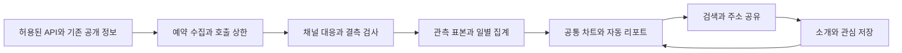

# VDébut 리소스 자동화와 API 중심 출시 계획

> **현재 문서의 위치**: 이 문서는 이전 대안을 보존한 자료다. 서비스 방향과 현재 작업 범위는 [22번 전체 기획](./22_SERVICE_ADVANCEMENT_MASTER_PLAN.md)과 [30번 첫 고도화](./30_FIRST_RELEASE_FINAL_PLAN.md)를 우선한다. 아래 카드·다기능·채팅/API 중심 출시안을 현행 요구사항으로 승계하지 않는다.

- **문서명**: VDébut 리소스 제작·API 활용·1차 출시 실제 지출 계획
- **버전**: v1.2 이전 다기능·API 대안 보존
- **최종 수정일**: 2026-11-11 KST
- **작성자/담당**: Codex 기획 보완 · 프로젝트 담당자 검토
- **상태**: 개발 전 방향 수정안 · 코드·운영 DB·배포 변경 없음
- **관련 문서**: [전체 기획](./22_SERVICE_ADVANCEMENT_MASTER_PLAN.md), [DB 설계](./23_ADVANCEMENT_DATA_DESIGN.md), [개발 목록](./24_ADVANCEMENT_BACKLOG_AND_COST.md), [이전 출시안 재검토](./25_FIRST_RELEASE_REVIEW_AND_PLAN.md)

**최신 방향 검토는 [27번 문서 10절의 카드·채팅 취향 발견 비교](./27_CORE_FUN_DECISION_AND_SIMULATION.md#10-같은-사용자로-다시-비교--최신-의사결정)다.** 성장 카드 우선 권장은 보류하고 실제 탐색 과제·재방문·후보 공급을 비교한다. 공통 템플릿·API로 만드는 카드와 저렴한 유료 분석은 계속 비교 후보이며 무조건 제외하지 않는다. 이번 검토는 실제 개발을 시작하거나 구현 범위를 확정하는 결정이 아니다.

아래 대시보드·관심 모아보기·자동 주간 리포트 3개 출시·23~36일·방송 수집 비용은 이전 대안으로 보존한다. 별도 신규 기능 3개를 함께 개발하는 요구사항이 아니다. 반복 수작업·개별 아트의 제작 부담을 줄이는 원칙과 API의 한계는 참고하되, 자동 데이터 카드까지 초기 제외하는 것으로 해석하지 않는다.

핵심 문장은 **“내 취향의 버튜버를 발견하고, 데뷔부터 성장까지 함께하는 곳, VDébut.”**를 유지한다. 차별점은 인기순 통계만 보여주는 데서 나아가 **신인의 소개와 관측 가능한 성장 기록을 관심 목록에 연결하는 경험**으로 잡는다. 경쟁 우위가 입증된 표현은 아니다.

## 1 리소스 제작의 채택·제외 기준

| 채택 기준 | 구체적 의미 |
| --- | --- |
| 반복 제작 없음 | 공통 화면·차트·문구 규칙을 한 번 개발하고, 채널·기간별 내용은 데이터로 구성 |
| 데이터 출처 확보 | API 필드·허용 범위·호출 한도·갱신 주기·누락 처리를 확인할 수 있음 |
| 외부 제작비 없음 | 유료 아트·영상 편집·이미지 생성·음성·데이터 구매를 초기 필수 조건으로 두지 않음 |
| 부족할 때 생략 가능 | 사진은 이니셜, 미제공 지표는 미표시. 사람이나 AI가 내용을 만들어 메우지 않음 |
| 유지·중단 가능 | 수집 실패를 표시하고 캐시·재집계·정정·철회·수집 중단을 처리할 수 있음 |

반복 수작업 없이는 유지되지 않는 콘텐츠는 출시 범위에서 제거한다. 공통 화면을 만드는 일회성 개발, 최초 채널 대응 확인, 오류·권리 요청·정정 대응은 남는다. 자동화가 이런 판단과 대응까지 없애 준다고 가정하지 않는다. 데이터 이용 조건 확인도 한 번의 형식적 작업으로 끝내지 않는다.

## 2 무엇을 어떻게 제작할 것인가

| 리소스·기능 | 입력 | 자동 구성 방식 | 결정 |
| --- | --- | --- | --- |
| 방송·성장 대시보드 | 관측 시청자·제목·카테고리·시각·일별 팔로워 | 공통 차트·표·변화 수치. 외부 대시보드 SaaS 없음 | R1 핵심 |
| 관심 채널 모아보기 | 기존 관심 저장·공개 일정·수집 상태 | 기존 관심 본문에 공통 행·상태 표시 | R1 핵심 |
| 주간 리포트 | 검증된 일별 집계·표본 수·기간 | 고정 문구 규칙과 숫자로 HTML 생성. AI 요약 없음 | R1 핵심 |
| 프로필 표시 | 허용된 공식 이름·이미지·채널 URL | 표시 조건에 따라 사용, 미허용·삭제·실패 시 이니셜 | 기존 자산 재사용 |
| 공유 리소스 | 리포트 고정 주소·기존 브랜드 이미지 | 주소 공유·고정 OG 재사용. 방문마다 PNG 생성하지 않음 | R1 포함 |
| 데이터 카드·배지 | 같은 집계와 공개 가능한 기록 | 공통 HTML/CSS/SVG에 값 결합. 채널별 일러스트 없음 | 27번의 단일 핵심 권장안 |
| 방송 예측 놀이 | 시작·종료가 검증되는 방송 기록 | 공통 선택 화면·자동 결과 확정·점수 | 품질 조건 충족 후 R2 |
| 주식형 성장 추적 | 같은 출처의 일별 값·고정 계산 규칙 | 관심 채널 가상 지수·기간별 변화 차트 | R2 선택 실험 |
| 카드팩·시즌 카드·희귀 아트 | 수작업 아트 또는 자동 데이터 카드로 구분 | 공통 템플릿 카드와 개별 아트 제작 부담을 별도로 판단 | 개별 아트 반복 제작 제외. 자동 카드는 27번의 핵심 후보 |
| 장문 위키·수제 소개·팬아트·영상 자동 편집 | 사람 편집·출처 판단·추가 저작물 | 상시 검수·제작비가 필요 | 신규 핵심 범위에서 제거 |
| 채팅 워드클라우드 | 채팅 수집·보관·필터링·권한 | 별도 수집·운영 부담이 큼 | 초기 출시에서 제거 |

공통 양식은 화면 3종, 차트 유형 3종 이내(시계열·비교 막대·활동 분포)로 시작한다. 아이콘은 프로젝트의 기존 자산을 사용하고 신규 폰트·일러스트·이미지 생성 구독을 구매하지 않는다. 공통 코드와 데이터 참조를 재사용하며 채널·사용자마다 이미지 파일을 복제하지 않는다. 영상은 기존 허용 임베드·원문 이동만 사용하고 재호스팅하지 않는다.

## 3 이전 다기능 출시안 — 현행 핵심 선정은 27번 우선

| 순서 | 기능 | 이용자에게 주는 이유 | 유입·재방문 연결 |
| --- | --- | --- | --- |
| 1 | 방송·성장 대시보드 | 지금 관측된 방송과 수집 시작 이후 변화를 확인 | 채널·방송 기록 검색 → 소개 → 공식 채널 이동 |
| 2 | 관심 채널 모아보기 | 좋아하는 채널의 상태·기록을 한곳에서 확인 | 관심 저장 → 다음 방문에 달라진 상태 확인 |
| 3 | 자동 주간 리포트 | 매주 기록을 비교하고 신인의 활동을 소개 | 채널별 고정 주소 공유 → 소개 유입 → 관심 저장 |

재미는 처음부터 복잡한 게임 경제를 만드는 대신 내 관심 채널의 변화·새 기록·같은 기간 비교에서 시작한다. 보고서 주소는 데이터가 충분하고 이용 조건이 허용되는 채널에만 공개한다. 내용이 빈 페이지를 대량 생성하거나 숫자만 나열했다고 검색 순위·AdSense 승인이 보장된다고 보지 않는다.

리포트의 기본 문구 예시는 “이번 주 관측 최고 시청자 {n}명 · 유효 관측 {k}회 · 팔로워 {a}명 → {b}명”이다. 관측 최고값은 실제 방송 전체 최고값과 구분한다. 팔로워 변화는 양 끝 날짜의 유효 값이 있을 때만 계산한다. 7일 미만은 ‘누적 현황’으로 제공하고 전주 비교는 두 기간 모두 기준을 만족할 때만 공개한다. 없던 과거 값·데뷔일·성격을 추론해 채우지 않는다.

## 4 API로 확보할 수 있는 것과 한계

확인일은 2026-11-10이다. 코드에 조회 기능이 있다는 사실과 공식 지원·재배포 허용은 다르다. API 승인은 이번에 신청하지 않았고, 실제 계정별 호출 한도·응답·보관 조건은 확인 전이다.

| 대상 | 확인한 사실 | 초기 사용 판단 |
| --- | --- | --- |
| 치지직 채널 정보 | 공식 API에서 최대 20개 채널 ID 묶음과 이름·이미지·팔로워 필드 제공 | 등록 채널 30개 이내, 하루 1회 갱신 후보. 사용·보관 조건 확인 후 채택 |
| 치지직 라이브 목록 | 공식 목록은 시청자 순, 페이지당 최대 20개, 다음 페이지로 조회 | 5분 간격·회당 최대 10페이지 시험 상한. 전체 채널 직접 추적과 구분 |
| 현재 내부 조회 경로 | 기존 수집 코드 일부는 `api.chzzk.naver.com/service/...`, SOOP `chapi.../station` 사용 | 동작을 공식 계약·안정성의 근거로 간주하지 않음. 공식 경로와 검증·대응 |
| SOOP | 공식 개발자 센터·권한 체계 존재. 이번 조사에서는 상세 API 명세·타인 채널 범위·과금까지 확정 못함 | 사용할 필드·승인·비용 확인 전 첫 출시 의존성에서 제외 |
| YouTube | 공식 API에도 호출량 제한이 있고, 검색·영상 정보 조회의 예산을 나눠야 함 | 새 방송의 전 채널 반복 검색은 제외. 기존 링크를 유지하고 별도 검증 후 확장 |

근거: [치지직 채널 API](https://chzzk.gitbook.io/chzzk/chzzk-api/channel), [라이브 API](https://chzzk.gitbook.io/chzzk/chzzk-api/live), [인증·오류 규격](https://chzzk.gitbook.io/chzzk/chzzk-api/tips), [SOOP 개발자 센터](https://developers.sooplive.co.kr/), [SOOP 권한 체계 공지](https://sotong.sooplive.com/?b_no=9999&board_type=servicenotice&check_content=true&check_title=true&page=2&work=view), [YouTube 공식 할당량](https://developers.google.com/youtube/data/determine_quota_cost).

특히 인기 목록의 앞 200개에 없는 채널은 **미관측**이다. 목록에서 사라졌다고 방송 종료·시청자 0명으로 저장하지 않는다. 전체 목록을 빠짐없이 수집하거나 허용된 채널별 상태 조회가 검증되기 전에는 정확한 방송시간·종료 예측 정산·시장 전체 점유율을 제공하지 않는다. 신인이 빠지는 문제를 인기순 수집만으로 해결했다고 주장하지 않는다.

최소 출시는 일별 팔로워와 관측된 라이브 정보로 구성할 수 있다. 직접 추적이 불가능하면 해당 지표를 제외한다. 필수 지표의 이용 조건도 충족하지 못하면 유료 대체 서비스를 자동 도입하지 않고 출시 범위를 다시 정한다. 플랫폼별 데이터 가공·점수화·재노출 조건은 게임 도입 전에 추가 확인한다.

## 5 자동 제작·갱신 흐름



1. 채널 ID·원문 URL·허용 근거·정책 확인일·갱신 주기를 저장한다. 비밀 키는 브라우저로 보내지 않는다.
2. 공통 예약 수집기가 외부 API를 호출한다. 방문자마다 외부 호출·AI 작업을 실행하지 않는다.
3. 유일 키로 같은 슬롯의 중복 수집을 막고, 실패·부분 성공·미관측·명시적 종료를 구분한다. 429·일시 오류는 지연 재시도하되 전체 호출 상한 안에서 처리한다.
4. 집계 버전을 고정해 일별·주별 값을 만들고 재집계 시 원본과 결과를 대조한다. 최초 양식·규칙만 사람이 검토하고 정상 리포트마다 수동 승인을 요구하지 않는다.
5. 리포트는 채널·기간·버전 단위로 한 번 발행한다. 자료 부족이면 발행을 보류하거나 확보된 지표만 제공한다.
6. 출처 삭제·권리 철회·지표 오류는 공개 중단·캐시 무효화·정정 이력으로 처리한다. 외부에 저장된 공유 미리보기까지 회수한다고 약속하지 않는다.

신규 데뷔 조사·위키는 후보 추출·중복 확인·근거 링크 수집까지 자동화하고 사실 확정과 공개는 검토를 유지한다. 이 흐름은 후속 범위이며 R1 운영을 매주 수제 콘텐츠 작성에 의존시키지 않는다. 기존 조사 CSV의 정본과 T/F 규칙은 유지하고 이번에 CSV를 변경하지 않는다.

## 6 주식·예측 아이디어의 현실적인 형태

| 단계 | 실험 | 필요한 조건 | 만들지 않는 것 |
| --- | --- | --- | --- |
| R1 | 성장 추이·같은 기간 비교·주간 기록 | 일별 관측과 품질 표시 | 개인 시청 인증·가상의 과거 수치 |
| R1.1 | 자동 데이터 배지·새 채널 추천 | 표시 권리·공통 배지 규칙·유효 후보 | 시즌별 수작업 아트·희귀도 운영 |
| R2 우선 | 다음 기간 지표 구간 맞히기 또는 방송시간 예측 중 1종 | 결과 필드·마감 시각·결측 취소·자동 재정산 검증 | 수동 판정으로 결과를 메우는 운영 |
| R2 선택 | 가상 성장 지수와 관심 포트폴리오 | 동일 출처 최소 14일, 지표 가공 허용, 기준값·변경 이력 | 현금·유료 재화·거래소·결제·환전 |

지수 예시는 `100 × 오늘 팔로워 / 시작일 팔로워`처럼 공개한 고정 규칙으로 계산할 수 있다. 이는 기획용 산식이며 해당 플랫폼에서 허용되는지 확인한 구현안은 아니다. 시작일 0·누락·계정 변경은 지수 미발행, 급변·정정은 일시 보류·같은 버전 재계산으로 처리한다. 인물 가치나 공식 금융 가격으로 표현하지 않는다. R1에는 이 지수·포트폴리오·점수 원장을 구현하지 않는다.

예측 놀이를 열려면 해당 대상의 필수 관측 충족률 95% 이상을 내부 기준으로 검증하고, 마감 뒤 입력 변경 차단·재시도 중복 방지·결측 자동 취소를 확인한다. **인기 목록만 관측한 경우에는 전체 방송의 기대 표본 수를 알 수 없어 이 조건을 충족했다고 판정할 수 없다.** 시청자 수로 가격을 움직이면 누락·봇·휴방이 결과를 왜곡하므로 초기 게임 기준으로 채택하지 않는다. 게임 화면을 먼저 만들고 데이터는 나중에 확보하는 순서를 피한다.

이 게임들은 개별 아트 제작비를 없앨 수 있지만 개발·운영까지 단순해지는 것은 아니다. 계정·마감·점수 원장·중복 정산·부정 참여 처리가 추가되므로 R1의 비용·작업일에 포함하지 않는다. R2에서는 예측과 모의 거래를 동시에 만들지 않고, 이미 확보한 데이터로 자동 판정 가능한 한 가지 실험의 DB 쓰기·CPU 예산부터 따로 산정한다.

## 7 이전 다기능 안의 개발 순서와 DB — 현행 27번 우선

| 순서 | 세부 개발 목록 | 완료 기준 | 작업일 가정 |
| --- | --- | --- | ---: |
| S1 | 기존 수집·관심·저장 구조 대조, API 허용 조건·한도·필드, 운영/개발 환경 분리안 | 재사용과 신규 작업 구분·사용 가능 지표 확정. 조건 미충족 시 범위 축소 | 3~5 |
| S2 | 공식 API 어댑터·채널 대응·슬롯·재시도·호출 상한·결측 | 중복 저장 없음, 실패가 0명·종료로 바뀌지 않음 | 5~8 |
| S3 | 일별 값·표본 집계·기간 비교·품질·보관 만료·재집계 | 같은 원본과 버전의 결과 일치, 정정 가능 | 4~6 |
| S4 | 기존 대시보드·관심 본문 연결, 차트·캐시·공식 이동 | 비로그인 사용 유지, 범위·지연 표시, 메인 보존 | 4~6 |
| S5 | 주간 리포트·고정 주소·공유·유입 계측·발행 중단 | 수동 편집 없이 발행, 기간·버전별 중복 없음 | 3~5 |
| S6 | 모바일·회귀·삭제·복구·비용 측정·제한 공개 | 정상·장애·과부하 조건과 기존 화면 보존 확인 | 4~6 |
| 합계 | 기존 구현 확인 후 재산정 | 인건비로 환산하지 않음 | **23~36** |

주 5일 집중과 25% 여유 기준 약 6~9주다. 실제 가용 시간·기존 코드 상태에 따라 달라지며, 외부 승인 대기와 출시 후 4주 관찰은 별도다. S2 이후 수집을 시작해 UI 개발과 자료 축적을 겹칠 수 있다. 7일 자료가 없으면 주간 비교로 공개하지 않는다.

| DB 영역 | 최소 필드·키 | 보관·설계 |
| --- | --- | --- |
| 추적 설정 | 플랫폼·채널 ID UNIQUE, 프로필 ID·허용 근거·확인일·활성 상태 | 기존 프로필 ID와 채널 대응 재사용 |
| 수집 회차 | 플랫폼·범위·슬롯 UNIQUE, 성공/부분/실패·페이지 수·호출 수 | 중복 실행 방지·오류 추적 |
| 방송 표본 | 채널·방송 ID·관측 슬롯 UNIQUE, 시청자 NULL 허용·시각·품질 | 원본 14일. 조회·만료 인덱스 |
| 일별 채널 값 | 채널·날짜·버전 UNIQUE, 팔로워·원문 시각·누락 상태 | 365일 이내, API 조건이 더 짧으면 그 조건 우선 |
| 방송 일별 집계 | 채널·날짜·버전 UNIQUE, 관측 최고값·표본 수·범위 | 실제 방송시간과 관측시간 분리 |
| 자동 리포트 | 채널·기간·버전 UNIQUE, 집계 참조·상태·문구 버전 | 원본 복제보다 집계 참조·철회 우선 |
| 제품 측정·운영 | 열람·관심·공식 이동·출처·집계 버전·정정 이력 | 기존 체계 재사용, 제품 이벤트 원본 30일 |

위 영역을 모두 신규 테이블로 만든다는 뜻은 아니다. 현재 `analytics_broadcast_runs`·`analytics_broadcast_snapshots` 등과 대조해 확장 여부를 S1에서 확정한다. 카드용 23개 테이블과 `engagement_db`는 R1에서 제거한다. 회원·카드 지급·주식 정산 테이블도 만들지 않는다. 필요하면 분석 D1 하나를 분리하되 기존 ID·공개 주소·프로필 데이터는 이관하지 않는다.

## 8 홈페이지 무게와 운영 비용을 제한하는 방법

메인 하이라이트·캘린더·`CalendarPage`의 `PortalStage` 연결·공통 Header·Footer를 보존한다. 기존 통계·상세·목록·관심 본문에서 연결하며 새 메인이나 메뉴 개편을 포함하지 않는다.

- 차트는 해당 화면 진입 시 로드하고 메인 초기 묶음에 포함하지 않는다. 기존 차트 구성 재사용을 우선한다.
- 7일 시간 집계 기본 최대 168점, 목록 20~50개, 동시 비교 3개로 제한한다. 긴 기간 원본을 브라우저로 내려보내지 않는다.
- 서버의 공통 수집은 5분, 화면 갱신은 보이는 동안 60초 이상 간격으로 캐시를 읽는다. 초 단위 실시간을 약속하지 않는다.
- 별도 상시 서버·채팅 연결·유료 대시보드·이미지 변환·AI API·메일 발송을 도입하지 않는다.
- 정상 응답 전체를 로그에 저장하지 않고 집계·오류·표본만 남긴다. 실제 모바일 속도·DB 행 수·CPU는 구현 후 측정한다.

## 9 인건비를 제외한 실제 추가 지출

아래는 이전 다기능·라이브 목록 수집 모델이다. 현행 단일 핵심과 주식·예측·채팅 분석의 비교 비용은 [27번 문서 7절](./27_CORE_FUN_DECISION_AND_SIMULATION.md#7-추가-비용-비교--인건비-제외)을 따른다. 유료 API의 일괄 제외는 철회하며 사용량·효용·대안을 보고 판단한다.

### 9.1 월별 청구 항목

가격 확인일 2026-11-10, USD·세금·환전 수수료 제외다. 원화는 편의상 1달러=1,500원으로 환산하며 현재 환율을 뜻하지 않는다. 현재 구독·청구·잔여 포함량은 조회하지 않았으므로 전체 서비스 청구 확정액이 아니다.

| 항목 | R1에서 새로 나가는 월 비용 | 전제 |
| --- | ---: | --- |
| Workers 웹·API·예약 수집 | 기존 Paid이면 기본료 추가 $0 / 새 Paid 가입 시 $5 | 계정 기본료, 아래 모델과 기존 사용량 합계가 포함량 이내 |
| D1 읽기·쓰기·저장 | 초과 요금 예상 $0 | Paid 계정의 잔여 포함량 내. DB마다 $5 반복 없음 |
| 이미지·리포트 리소스 | 신규 외부 서비스 $0 | 공통 HTML/CSS/SVG·기존 고정 OG 사용, 신규 R2 필수 아님 |
| 외부 데이터 API | 구매 예산 $0 | 무료로 허용된 경로만 채택. 유료 계약 필요 시 해당 플랫폼 제외 |
| 로그인·메일·문자·AI·유료 검색 | $0 | R1에 신규 도입하지 않음 |
| 로그·오류 확인·HTTPS | 신규 유료 계약 $0 | 기존 기능·포함량 사용, 로그 초과분은 별도 |
| 도메인 | 새 구매 $0 | 기존 도메인 재사용. 연간 갱신은 현재 계약 금액 유지 |
| VPS·상시 수집 서버·유료 차트 SaaS | $0 | 도입하지 않음 |

**이미 Paid이고 포함량이 남으면 월 증분 $0, 새로 Paid가 필요하면 월 $5부터(예산 환산 약 7,500원)**가 기준이다. $5는 최대 청구 보장이 아니다. 기존 서비스·개발 환경 사용량이 포함량을 소진하면 초과 요금이 붙는다. 기존 서버·KV·도메인 비용은 계속 발생하므로 ‘사이트 전체 운영비가 $0’라는 뜻이 아니다. 개발·운영 인건비와 시간의 금액 환산은 제외한다. 별도 일회성 외부 제작·서비스 가입비도 필수 항목으로 잡지 않는다.

이전 월 $20~50은 임의의 관리 예비비였으므로 필수 지출 전망에서 제거한다. 필수 유료 API·유료 자산이 발견되면 예산에 숨겨 넣지 않고 해당 기능을 제거하는 것이 이번 기준이다.

### 9.2 읽기·쓰기·저장 계산

30일·추적 후보 C=30·DAU D=100·5분 수집·회당 라이브 목록 최대 10페이지·팔로워 하루 1회·제품 이벤트 하루 10건/인 가정이다. 라이브 관측 범위는 제한되며, 아래 상한은 저장·과금 예산을 위한 가정이다.

```text
F = 30 × 288 × 10 + ceil(C / 20) × 30 = 86,460  # 최대 외부 API 요청
S = C × 관측된 방송시간 × 60 / 5 × 30           # 저장 표본
E = D × 30 × 10
R = D × 30 × 40 × 0.25 × 50 + S × 2 + 100,000
W = S × 8 + C × 30 × 12 + E × 4 + D × 30 × 24 + 20,000
G = 0.02 + (S / 30 × 14 × 700 + C × 365 × 400 + E × 500) / 1e9
Q = D × 30 × 40 + 8,640
CPU = D × 30 × 40 × 5 + 8,640 × 200 + S × 2 + C × 30 × 100
```

| 월 사용량 | 채널당 관측 6시간/일 | 채널당 24시간/일 저장 상한 |
| --- | ---: | ---: |
| 저장 표본 S | 64,800 | 259,200 |
| D1 읽기 R | 1,729,600 | 2,118,400 |
| D1 쓰기 W | 741,200 | 2,296,400 |
| 신규 DB 점유 G | 약 0.0605GB | 약 0.1241GB |
| 요청 예산 Q | 128,640 | 128,640 |
| CPU 예산 | 2,547,600ms | 2,936,400ms |
| Paid 잔여 포함량 내 초과 요금 | $0 | $0 |

S당 8행은 저장·인덱스·집계·만료 삭제를 활동량에 배분한 예약치다. R은 반환 수가 아닌 스캔 행이다. G는 14일 원본·365일 일별 집계·30일 제품 이벤트·20MB 메타데이터 가정이다. 조회·정리·초기 적재·인덱스의 실제 행 수와 크기로 교체한다. Q는 Cron을 요청 예산에도 넣은 보수적 수치이며 동일한 요청 과금이라고 주장하지 않는다. 플랫폼으로 보내는 F를 Worker 인바운드 요청 요금에 다시 더하지 않는다.

Paid 포함량은 요청 1,000만 회·CPU 3,000만 ms, D1 읽기 250억 행·쓰기 5,000만 행·저장 5GB다. 새 DB에 별도 포함량이 생기는 것이 아니라 기존·개발 사용량과 공유한다. [Workers 요금](https://developers.cloudflare.com/workers/platform/pricing/), [D1 요금](https://developers.cloudflare.com/d1/platform/pricing/)

Free도 모든 일별·개별 실행 한도를 만족하면 $0이 가능하지만, 상한 모델의 D1 쓰기는 일평균 약 7.65만 행으로 무료 일 쓰기 10만 행 대비 여유가 적다. 몰아서 삭제하는 날·재시도·기존 사용량까지 고려해 Paid $5를 기준안으로 둔다. 외부 API 86,460회도 허용이 확인된 수가 아니므로 호출 한도에 맞춰 페이지·주기·대상을 줄인다. 유료 API를 구매해 상한을 메우지 않는다.

### 9.3 실제 청구 확정과 중단 기준

`실제 추가 청구 = 도입 후 계정 청구 - 기존 계정 청구`로 계산한다. 기존 수집을 대체하면 중복량을 차감하고, 신규 DB 전체 이관·이미지 저장·사용자 계정이 없는 R1 모델과 섞지 않는다. 현재 Workers Sites의 KV 자산 비용을 최신 Static Assets 무료 조건으로 바꾸어 계산하지 않는다.

출시 전 7일 동안 정상·실패·재시도별 사용량을 측정한다. 추가 청구 월 $10 예상은 내부 점검선으로 제안하며 필수 예산이나 자동 결제 차단 한도가 아니다. 호출 상한·재시도 상한·보관 만료·수집 중단을 함께 설계한다. 2026-12-01부터 바뀌는 [Observability 요금](https://developers.cloudflare.com/observability/pricing/)도 실제 출시 직전 재확인한다.

## 10 출시와 지속 발전 판단

100~300명에게 4주 시험하고 수집 실패율·관측 범위·리포트 자동 발행·관심 저장·공식 링크 이동·D7 재방문을 실제 인원수와 함께 본다. 공식 이동은 실제 시청·구독 증가가 아니다. 아직 7일이 지나지 않은 이용자는 D7 분모에서 제외하고 미리보기 봇·관리자·시험 계정을 구분한다.

출시 조건은 API 허용 범위·결측 처리·중복 방지·공개 중단·보관 만료·복구·모바일 성능·기존 화면 보존·7일 비용 확인이다. 반복 리소스 제작이 필요한 기능은 지표가 좋아도 확대하지 않는다. 이용자가 기록을 보러 돌아오는지 먼저 확인하고, 그 데이터가 예측·성장 추적 놀이의 조건을 충족할 때 다음 기능을 붙인다.

이번 작업은 문서 보완이며 실제 개발·유료 가입·API 신청·외부 연락·수집 실행·DB 생성·운영 데이터 변경·배포는 수행하지 않는다.
