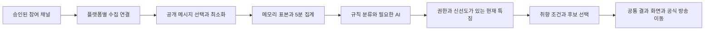

# 채팅 기반 취향 발견의 구현 가능성 검토

- **문서명**: 치지직·SOOP 채팅 수집 권한, 분석·추천, 신인 처리와 월 비용
- **버전**: v1.4 장기 선택 기능의 기술 참고
- **최종 수정일**: 2026-11-11 KST
- **작성자/담당**: Codex 공식 문서 조사·기획 · 프로젝트 담당자 검토
- **상태**: 개발 전 타당성 검토 · API 신청·실제 수집·DB 변경·배포 미실행
- **연결 문서**: [사용자 동선과 재방문 비교](./27_CORE_FUN_DECISION_AND_SIMULATION.md#10-같은-사용자로-다시-비교--최신-의사결정), [전체 기획](./22_SERVICE_ADVANCEMENT_MASTER_PLAN.md)

**현행 기획과의 관계**: [22번 전체 고도화 기획](./22_SERVICE_ADVANCEMENT_MASTER_PLAN.md)과 [30번 첫 고도화 범위](./30_FIRST_RELEASE_FINAL_PLAN.md)가 우선한다. 이 문서의 카드·채팅·수집 방식 비교는 이전 후보 자료로 보존한다. 채팅 수집·기술 검증·외부 문의를 현재 서비스 기획의 선행 단계로 두지 않는다. 아래 과거 판단을 현행 요구사항으로 승계하지 않는다.

## 1 결론과 적용 조건

**현재 역할**: 채팅 화제 분석을 장기 선택 기능으로 검토할 때 참고할 공식 경로·권한·비용 자료다. 공식 직접 채팅 수집을 첫 고도화의 우선안으로 두지 않는다.

**후속 조사인 [29번 운영 사례·사업 경로 검토](./29_COMPETITOR_CHAT_DATA_AND_BUSINESS_REVIEW.md)를 함께 적용한다.** 아래는 공식 API·SDK 경로의 검토다. 소프트콘·SSAPI의 데이터 공급 제휴 사례가 추가 확인되어 공식 참여형과 공급 제휴를 비교 대상으로 둔다. 제휴용 숫자 통계와 본문 분석 권한은 다르며, 공급자 승인만으로 플랫폼·작성자 관련 조건까지 해결됐다고 가정하지 않는다. 제휴 단가·우리 용도 승인은 미확정이다.

**분석·추천 기능은 기술적으로 구성할 수 있다. 다만 ‘동의 없이 모든 방을 수집하고 광고를 붙이는 서비스’로 바로 출시할 수 있다는 결론은 아니다.**

| 판단 대상 | 현재 결론 |
| --- | --- |
| 치지직 참여 스트리머의 채팅 분석 | 공식 이벤트·사용자 인증 경로가 있어 조건부 기술 검증 가능 |
| SOOP 참여 스트리머의 채팅 분석 | 심사 대상 Chat SDK와 본인 방송·브라우저 제약 확인. 중앙 서버 수집 구성은 추가 확인 필요 |
| 플랫폼 전체 신인 자동 수집 | 현재 확인한 공식 채팅 권한으로 보장되지 않음 |
| 화제·채팅 속도 기반 추천 | 표본·신선도를 구분하면 가능. 방송인의 목소리·성격·팬덤 친절도까지는 판정하지 않음 |
| 채팅이 적은 신인 | 데이터 부족을 표시하고 방송 정보에 근거한 발견 후보로 제공. AI로 빈 성향을 만들지 않음 |
| 광고 BM | 치지직 약관의 광고·대가 수취 금지와 SOOP의 사전 동의 조건을 먼저 해결해야 함 |
| 초기 비용 | 허용 범위를 확보한 치지직 참여형·소규모 수집 서버 기준으로 산정. SOOP 통합 확정 견적 아님 |

실행 순서는 **용도와 권한 확인 → 승인 가능한 참여 채널 확보 → 기술 검증 → 추천 효용 검증 → 제한 출시**다. 비용표가 낮다는 이유로 앞의 조건을 생략하지 않는다. 조사 결과와 설계 제안을 구분하며, 아래 성능·표본·예산 수치는 실제 측정값이 아니다.

## 2 공식 경로로 받을 수 있는 데이터와 권한

### 2.1 치지직

앱 등록과 API 사용 승인, 참여 방송인의 OAuth 동의 및 `채팅 메시지 조회` 범위가 전제다. 앱의 Client 인증만으로 임의의 모든 방을 읽는 경로로 해석하지 않는다. 사용자 토큰으로 해당 사용자의 채팅 이벤트를 세션에 구독하는 구성이다. 시청자가 우리 사이트에 로그인했다고 다른 스트리머의 채팅 수집 권한이 생기는 것은 아니다.

수집 후보는 공식 `CHAT`의 채널 ID·작성자 채널 ID·본문·메시지 시각·이모티콘·역할이다. 닉네임·배지 등 추가 프로필은 제공돼도 추천에 불필요하면 저장하지 않는다. 클라이언트 연결 최대 10개, 세션당 이벤트 구독 최대 30개이며 후원·구독 이벤트도 같은 한도를 사용한다. 채팅만 구독하는 안으로 시작한다. 문서의 Socket.IO-client 지원은 1.0.0~2.0.3이므로 최신 클라이언트를 바로 연결하면 된다고 가정하지 않는다. [공식 세션·이벤트 명세](https://chzzk.gitbook.io/chzzk/chzzk-api/session)

인증은 서버에서 code를 토큰으로 교환한다. 현재 명세의 Access Token은 1일, Refresh Token은 30일이며 갱신 토큰은 일회용이므로 갱신 경쟁을 막고 새 토큰을 안전하게 교체해야 한다. 비밀 키와 갱신 토큰은 방문자나 외부 AI로 보내지 않는다. [공식 인증 명세](https://chzzk.gitbook.io/chzzk/chzzk-api/authorization)

### 2.2 SOOP

개발자·앱 등록 후 채팅 기능을 포함하는 **`broad_access_chatinfo`** 범위를 확인해야 한다. 공식 범위 명칭은 조회·전송·관리 등을 함께 포함한다. 구현은 수신만 사용하더라도 이 범위를 읽기 전용 권한처럼 설명하지 않는다. 앱별 승인 범위와 방송인의 인증이 필요하다. [공식 인증·Scope 명세](https://developers.sooplive.co.kr/docs/api/auth-token)

채팅 메시지 조회·연결 문서는 **Consent**로 표시된다. Consent는 회사 심사가 필요한 범위이며 기능·관련 스트리머·개인정보처리방침 등을 제출하는 절차다. [앱·심사 절차](https://developers.sooplive.co.kr/docs/chatsdk/getting-started)

SDK는 브라우저 JavaScript 환경을 지원하며 현재 **본인 방송에만 접속 가능**하다고 명시한다. 타 방송 접속은 향후 계획이지 현재 제공 기능으로 계산할 수 없다. 따라서 스트리머 참여와 인증 없는 전수 수집도, 이 SDK가 Node.js나 Workers에서 그대로 실행된다는 전제도 두지 않는다. [지원 환경](https://developers.sooplive.co.kr/docs/chatsdk/overview), [연결 범위](https://developers.sooplive.co.kr/docs/chatsdk/connection)

이 제약은 확인한 **공개 SDK 경로**에 대한 것이다. 별도 공급 제휴·플랫폼 계약을 통한 모든 중앙 수집까지 기술적으로 불가능하다는 뜻은 아니다. 후속 조사에서 확인한 중계 데이터 공급은 별도의 이용 권한·범위·가격을 검토한다.

일반 `MESSAGE`에는 작성자 ID·닉네임·본문·사용자 상태·이모티콘 관련 필드 등이 있다. 권한상 다른 이벤트가 전달될 수 있어도 귓속말·매니저 전용 대화·후원·구독·제재·구매 정보는 수집 입구에서 제외한다. 확인한 일반 메시지 표에서 원본 시각·공통 메시지 ID는 확정하지 못했으므로 수신 시각과 방송 세션을 별도 기록한다. 참여자 입장·퇴장은 전체 실제 시청 이력으로 취급하지 않는다. [메시지·이벤트 명세](https://developers.sooplive.co.kr/docs/chatsdk/get-message)

### 2.3 두 플랫폼의 기술 차이가 출시 범위에 주는 영향

| 항목 | 치지직 계획 | SOOP 계획 |
| --- | --- | --- |
| 중앙 수집 | 승인받은 사용자 토큰과 공식 세션으로 수집기 구성 후보 | 공식 서버 수집 방식·다중 인증 처리에 대한 확인 전 미확정 |
| 방송인 측 실행 | 중앙 수집이 성립하면 상시 웹페이지·OBS 설치를 필수로 두지 않는 방향 | 현재 브라우저 SDK만 쓰면 방송인 측 연결 페이지 등이 필요할 수 있음 |
| 역사 채팅 | 확인한 실시간 이벤트 문서에 과거 전체 재조회 경로 없음. 시작 전 자료 자동 복원 약속 없음 | 확인한 문서는 실시간 콜백. 과거 채팅 전체 조회를 전제로 두지 않음 |
| 장애 | 누락 구간 표시·제한 재연결·구독 상태 대조 | 연결 종료·인증·승인 상태 구분, 브라우저 중단 시 수집 공백 발생 가능 |
| 초기 권장 | 권한·약관을 해결한 참여 채널부터 검증 | 별도 플랫폼 허용·수집 구성이 확인되기 전 동시 출시 필수 범위에서 보류 |

SOOP 연동을 위해 비공식 채팅 프로토콜·공용 시청 계정·계정 쿠키 수집을 기본안으로 추가하지 않는다. 방송인 측 브라우저 수집이 승인되더라도 분석·서버 전송·재노출 허용과 연결 안정성은 별도 검증 대상이다.

## 3 수익화와 데이터 이용 조건 — 출시 전 결정 필요

적용 범위를 구분한다. 아래 개발자 약관은 해당 API·SDK 이용 계약과 데이터에 붙는 조건이다. 이 문구만으로 경쟁사의 수집 경로·개별 계약·상업 운영을 판단하지 않는다. 공식 API를 사용하지 않는 경로도 일반 서비스 약관·제공자 계약·콘텐츠 권리 등의 검토가 남는다. 네이버 현행 일반 약관의 자동 수집 제한, SOOP 현행 일반 약관의 정보 활용 제한 및 제휴사 활용 조항은 [29번 5절](./29_COMPETITOR_CHAT_DATA_AND_BUSINESS_REVIEW.md#5-약관-적용-범위의-정정과-보완)에 정리했다.

**치지직 개발자 센터 약관 제7조 제2항 제13호는 API 적용 앱의 광고 삽입 및 이용 대가 수취를 금지한다.** 제5조에는 API 사용 신청·승인 절차가 있고 제7조에는 지정 방식의 API 이용 표시 등 조건도 있다. 현재 약관만으로 AdSense·유료 홍보·구독을 붙일 수 있다고 판단하지 않는다. 다른 페이지에 광고를 두면 해결된다는 해석도 확인 전에는 채택하지 않는다. 별도로 허용되는 계약·조건이 있는지 확인되지 않으면 API 기반 기능에 광고 수익을 사업 전제로 넣을 수 없다. [공식 약관](https://developers.chzzk.naver.com/termsDetail)

**SOOP 약관 제11조**는 수익 활동에 사전 동의, 데이터 가공·재제공 및 파생 통찰의 제3자 제공에 회사 승낙·허가 조건을 둔다. 최종 이용자의 SOOP 로그인·ID 연계 조항도 있어 무로그인 외부 추천을 당연히 허용된 형태로 잡지 않는다. 제16조에는 권한 취소 등에 따른 데이터 삭제 조건이 있다. 자동 추천·외부 AI·집계 공개·광고·게스트 이용을 승인 범위에 명시해야 한다. [공식 약관](https://developers.sooplive.co.kr/terms)

위는 현재 게시 조건의 확인이며 별도 합의 가능성이나 회사의 승인 결과를 예측한 것이 아니다. 이번에 앱 신청·문의 발송·약관 동의는 실행하지 않았다.

권한은 세 층으로 나눈다. **플랫폼이 앱 용도·제공 조건을 허용하는 것, 스트리머가 자신의 채널 접근을 허용하는 것, 채팅 작성자 데이터의 적절한 처리 근거를 갖추는 것**은 서로 대체하지 않는다. 스트리머 OAuth만으로 원문 외부 AI 전송이나 시청자별 이력 공개까지 허용됐다고 보지 않는다. HMAC 처리한 식별자도 자동으로 완전 익명이 되는 것은 아니다.

회사에 확인할 내용은 승인 가능한 참여형 범위, 채팅 분석·집계 공개·보관·철회, 외부 처리업체 사용, 다중 채널 중앙 수집, 현재 방송 상태 조회, 게스트 추천, 광고·유료 홍보·구독 허용 여부다. 실제 계약 단가·개별 호출 한도가 확인되지 않은 부분을 무료·무제한으로 견적에 숨기지 않는다.

## 4 무엇을 분석할 것인가

분석 단위는 사람의 성격이 아니라 **채널의 특정 방송 세션·관측 구간**이다. 분류 항목은 게임 공략·게임 반응·음악/곡 이야기·일상 잡담·기타·판단 보류 정도로 시작한다.

| 정보 | 만드는 방법 | 추천에 쓰는 방식 |
| --- | --- | --- |
| 채팅 속도 | 유효 연결 시간당 공개 일반 메시지 수 | 사용자가 원하는 대화 흐름과 비교 |
| 메시지 집중 | 짧은 구간별 메시지 분포·반복 메시지 비중 | 순간 도배·한 번의 이벤트를 평상시 특성으로 오인하지 않음 |
| 표본 구성 | 구간별 서로 다른 작성자 수·상위 작성자 비중 | 분위기 분류 가능 여부 판단. 시청자 수로 표시하지 않음 |
| 반복 화제 | 개인정보를 제거한 후보 단어·표현이 여러 구간·작성자에서 반복되는지 | ‘최근 공략 이야기가 오감’ 같은 선택 이유 |
| 화제 전환 | 방송 ID·카테고리 변경·연속 구간의 주제 변화 | 이전 분류 만료·재분석 |
| 데이터 품질 | 연결 유효 시간·누락·표본 수·최신 시각 | 현재·과거·부족 상태 구분 |

‘ㅋㅋ’가 많아 친절하다, 이름 언급이 많아 폐쇄적이다, 채팅이 적어 목소리가 차분하다는 식의 평가는 하지 않는다. 목소리·방송인의 친절도·팬덤의 성격·실제 시청 시간은 이 입력으로 확인할 수 없다. 이모티콘과 웃음은 반응 표현으로 집계할 수 있지만 긍정 감정의 증거로 단정하지 않는다.

### 4.1 집계와 AI를 분리

1. **수신·정규화**: 플랫폼·채널·방송 ID·원본/수신 시각·공개 일반 메시지를 공통 형태로 처리한다. 연결 실패와 메시지 0건을 구분한다.
2. **전처리**: 알려진 봇·자동 명령·반복 도배·URL·개인 식별 표현을 걸러낸다. 봇 역할 정보가 없으면 모든 봇을 식별했다고 주장하지 않는다. 작성자별 분석 기여량을 제한하되 실제 메시지 속도와 의미 분석용 표본은 따로 집계한다.
3. **5분 집계**: 속도·표본 수·반복 화제를 계산한다. 원문은 기본 20분·채널당 최대 200건의 제한된 메모리 표본으로만 두고 장기 DB에 한 줄씩 쓰지 않는다. 희소 방에서 60분 구간을 검토하려면 허용된 보관 범위 안에서 해당 방의 제한 표본 TTL만 최대 60분으로 잡는다. 이미 버린 20분 이전 원문을 복원할 수 있다고 가정하지 않는다.
4. **기본 분류**: 카테고리와 사전 정의한 화제 사전으로 설명 가능한 것만 분류한다. 제목 기반 추정과 채팅에서 확인한 화제는 다른 출처로 둔다.
5. **선택 AI**: 표본이 충분하나 규칙으로 화제를 설명하기 어려운 경우에만, 허용된 처리 범위에서 비식별·최소 표본을 분류한다. 프롬프트를 포함한 실제 입력 토큰에 상한을 두고 긴 메시지·표본을 잘라 예산을 맞춘다. AI는 정해진 라벨·근거 키워드·보류만 출력한다.
6. **출력 검증**: 입력에 없는 근거·새로운 인물 평가·금지된 설명을 버리고, 신선도와 자료 조건을 통과한 결과만 게시한다. AI의 자기 확신 점수를 정확도로 사용하지 않는다.

외부 AI 허용이 없으면 식별자를 지웠다는 이유로 전송하지 않는다. 기본 집계·규칙형으로 검증하거나 외부 분류를 보류한다. 무료 모델 한도나 원문 전체 전송으로 비용을 낮춘다는 가정도 두지 않는다. 채팅에 들어 있는 명령문은 분석할 데이터이며 작업 지시·도구 실행 지시로 취급하지 않는다.

## 5 취향 입력과 추천 방식

시청자는 먼저 **오늘 보고 싶은 화제와 채팅 흐름**을 고른다. 처음부터 개인 채팅 이력이나 장문 설문을 요구하지 않는다. 치지직 참여형의 시청자 게스트 탐색은 제품 목표로 두되, SOOP 결합 시에는 약관의 로그인 조건을 먼저 확인한다.

추천 순서는 아래와 같다. 첫 출시에 벡터 DB·복잡한 협업 필터링·방문마다 LLM 호출은 필요하지 않다.

1. **이용 가능 조건**: 채널의 수집·분석·노출 권한이 유효하고, 언어·연령 설정 등 필수 조건이 맞는 후보를 고른다.
2. **현재 상태**: ‘지금 보기’는 실제 방송 중임을 유효한 근거로 확인한 채널만 대상으로 한다. 채팅 연결·최근 채팅 한 건만으로 방송 중을 확정하지 않는다.
3. **화제 일치**: 사용자가 고른 주제와 근거가 있는 화제 라벨을 먼저 비교한다. 적합성 97% 같은 가중 점수를 사용자에게 표시하지 않는다.
4. **대화 흐름**: 선택한 속도 범위와 실제 측정 흐름을 비교한다. 자료가 없는 채널을 조용한 방으로 취급하지 않는다.
5. **중복·다양성**: 이전에 제외한 채널 반복을 줄이고, 같은 그룹·카테고리로만 차지하지 않게 한다. 인기·채팅량이 많다는 이유로 우선하지 않는다.
6. **신인 발견**: 별도로 표시한 방송 정보 기반 후보를 섞을 수 있다. 이것을 채팅 취향 일치로 포장하지 않는다.

결과는 가능한 1~3개다. 예시 문구는 ‘최근 화제: 보스 공략·장비 세팅’, ‘최근 20분 채팅 흐름’, ‘방송 정보 기준으로 골랐어요’ 등이다. 실제 근거가 있을 때만 사용한다. 워드클라우드는 선택 이유를 보조하는 표현이며 추천 로직의 대체물이 아니다.

‘취향에 맞음/다름’, ‘이 채널 다시 추천하지 않기’, 오늘의 화제 변경을 같은 기능의 피드백으로 둔다. 클릭을 실제 시청·만족으로 해석하지 않고, 사용자 응답과 함께 적합성을 판단한다. 대화 속도나 관심사를 민감한 개인 성향으로 확장한 프로필은 만들지 않는다.

### 5.1 현재 방송 여부가 별도 선행 문제

치지직 공식 라이브 목록은 인기순·페이지당 최대 20개다. 앞부분에 없는 신인을 방송 종료로 저장하면 안 된다. 전체 페이지를 조회하거나, 별도로 허용된 채널 상태 확인 방법이 필요하다. [공식 라이브 명세](https://chzzk.gitbook.io/chzzk/chzzk-api/live)

예를 들어 동시 방송 3,000개를 전부 확인한다면 150페이지이고, 10분마다 30일 조회는 `150×144×30 = 648,000회`다. 이는 실제 동시 방송 수·허용 호출량이 아니라 호출량 문제를 보여 주는 가정이다. 앱별 제한·증분 조회·허용된 별도 상태 확인을 검증하지 못하면 ‘모든 참여 신인의 실시간 추천’을 출시 약속으로 두지 않는다. 상태 미확인은 프로필 탐색으로만 제공할 수 있고 그 경우 ‘지금 볼 방송’의 효용을 다시 검증해야 한다.

## 6 채팅이 적은 신인 처리

아래 수치는 초깃값 제안이며 통계적으로 검증된 신뢰도 기준이 아니다. 실제 신인 표본으로 통과율·오분류·노출 편중을 보고 조정한다.

| 관측 상태 | 임시 처리 규칙 | 사용자에게 제공할 것 |
| --- | --- | --- |
| 현재 표본 충분 | 최근 20분 일반 메시지 60건 이상·작성자 5명 이상·여러 구간의 반복 근거, 한 명의 과도한 지배 없음 | 조건을 통과한 현재 화제·채팅 속도 |
| 일부 자료 | 15건 이상·작성자 3명 이상 등 일부 근거만 있음 | 확인된 반복 키워드·측정 흐름만 제공. 방 성향 단정·과한 AI 설명 보류 |
| 최근 자료 부족 | 현재 구간을 최대 60분까지 늘려 검토하되 오래된 자료와 구분 | 기간을 명시한 제한적 기록. 최근 20분의 분위기로 표시하지 않음 |
| 현재는 부족·과거는 유효 | 최근 7일의 같은 카테고리·복수 방송에서 반복 근거가 있음 | ‘최근 방송 기록’으로 보조. 본 방송의 현재 화제로 승계하지 않음 |
| 여전히 부족·첫 방송 | 제목·카테고리·검토된 소개·일정 등만 확보 | 방송 정보 기반의 새 발견 후보. ‘채팅 자료가 쌓이는 중’ 표시 |
| 연결 실패·인증 만료 | 관측 자체가 불가능 | 분위기·속도 계산 보류. 자료 없음과 메시지 0건 구분 |

60건이어도 두 명이 전부 썼으면 방 전체를 대표한다고 보지 않는다. 반대로 채팅이 적다는 이유로 나쁜 방·추천 부적합 방으로 분류하지 않는다. 방금 연결한 방을 20분 내내 관측한 것처럼 계산하지 않는다. 방송 세션이 바뀌면 현재 표본도 새로 시작한다.

추천에는 **채팅 근거가 있는 후보와 정보 기반 신인 후보를 구분**한다. 예를 들어 3개 결과 중 최대 1개를 정보 기반 발견 후보로 제공할 수 있지만 적합한 현재 후보 수와 별도로 집계한다. 후보가 없을 때 허위 성향을 붙여 3칸을 채우지 않는다. 이 경로는 같은 추천 기능의 데이터 부족 처리이며 별도 카드 수집 게임을 추가하는 것이 아니다.

## 7 수집·저장 구조와 홈페이지 무게



초기 기준안은 기존 Cloudflare 웹·API·D1을 유지하고 **치지직 연결용 작은 Node.js 수집 서버 하나**를 분리하는 것이다. 공식 Socket.IO 호환성과 상시 연결을 먼저 확인하기 쉬운 구성으로 비용을 계산한다. 서버를 이번에 만들거나 계약하지 않는다. 서버 1개의 장애가 수집 중단으로 이어질 수 있어 상태 감시·재연결·복구와 데이터 만료가 필요하다.

Durable Objects에 연결을 묶는 대안도 있다. 다만 구형 Socket.IO 호환과 토큰별 구독을 검증하기 전 확정하지 않는다. 외부로 연결하는 WebSocket은 절전으로 비용이 사라진다고 가정할 수 없다. 이전 한 채널당 한 객체 비용도 최적 구성의 필수 비용은 아니었다. [공식 WebSocket 제약](https://developers.cloudflare.com/durable-objects/best-practices/websockets/)

SOOP은 이 Node.js 구성의 지원 범위로 자동 합산하지 않는다. 회사가 허용한 중앙 수집 경로나 브라우저 SDK 운영 방식이 확인되면 별도 설계·부하 검증·재견적한다. 브라우저 여러 개를 서버에서 임의로 띄우는 방식의 비용과 안정성을 숨겨 포함하지 않는다.

| 데이터 영역 | 최소 저장 | 보관·노출 계획 |
| --- | --- | --- |
| 플랫폼 연결·동의 | 채널·승인 범위·만료·철회·암호화한 토큰 참조 | 서버 전용, 승인·탈퇴·폐기 조건 우선 |
| 수집 세션·작업 | 방송 ID·연결 상태·누락·재시도·수집 버전 | 중복 실행과 장애 추적. 원문을 로그에 넣지 않음 |
| 5분 특징 | 채널·세션·구간 UNIQUE, 메시지 수·관측 시간·화제·품질 | 초기 7일 운영 보관 가정 |
| 현재 특징 | 채널·세션·종료 예정 TTL·출처 기간 | 캐시 가능한 작은 결과. 오래되면 현재 추천에서 제외 |
| 추천 피드백 | 노출·원문 이동·사용자 선택 피드백·버전 | 원본 30일 가정, 필요 최소 식별 |
| 중단·삭제·감사 | 철회·재분류·공개 중단·삭제 단계 | 캐시·백업 정책까지 함께 정리 |

기존 테이블과 대조한 뒤 확정할 영역이며 신규 DDL이 아니다. 메모리의 작성자 ID는 세션별 회전 식별자로 최소화하고 다른 채널·날짜의 개인 이력으로 연결하지 않는다. 집계만 저장할 경우 여러 구간의 작성자 수를 합쳐 주간 고유 이용자 수라고 표시하지 않는다.

두 플랫폼에 공통으로 항상 존재하는 메시지 ID를 확인한 것은 아니다. 재연결 구간은 중복 가능성과 공백을 기록하고, 가능한 원본 시각·세션·본문 지문으로 보조 처리하되 완전한 중복 제거를 약속하지 않는다. 집계도 출처별 보관·삭제 조건을 따른다. 원문·토큰이 서버 접근 로그·오류 추적·백업에 남지 않도록 설계한다.

화면은 현재 특징을 읽고 방문자마다 채팅 소켓이나 AI 호출을 만들지 않는다. 결과는 1~3개, 분석 코드는 방문자 브라우저로 배포하지 않는다. 모바일에서도 작은 JSON·공통 UI로 제공하고 실제 속도는 구현 후 측정한다. 메인 하이라이트·캘린더·`PortalStage` 연결·공통 Header·Footer는 보존한다.

## 8 월 비용 모델 — 인건비 제외

### 8.1 견적에 포함하는 것과 제외하는 것

이 절의 합계는 **데이터 공급 제휴료를 포함하지 않는다.** 후속 조사에서 제휴 경로가 확인됐으나 우리 용도 승인·단가는 미확정이다. 공급 제휴를 택하면 기존 수집 서버 비용을 그대로 유지하거나 제거하지 않고, 받는 데이터 규격·수신 방식·분석 부담에 맞춰 다시 계산한다. [제휴 경로의 비용 구분](./29_COMPETITOR_CHAT_DATA_AND_BUSINESS_REVIEW.md#8-비용과-출시-결정에-반영할-것)

**플랫폼이 해당 사용을 허용한 치지직 참여형**의 서버·DB·분석 비용 비교다. 현재 계정 청구·API 승인·성능을 실측한 값이 아니며 SOOP 통합 출시 견적도 아니다. 세금·환전 수수료·도메인 갱신·기존 KV·다른 서비스 사용량·별도 플랫폼 계약은 제외한다. 개발·운영 인건비는 합산하지 않는다.

수집 서버 예시는 DigitalOcean Basic의 월 $6(1GiB), $12(2GiB), $24(4GiB)다. 각각 5·30·100채널의 예산용 선택이며 그 규격이 해당 규모를 처리한다는 벤치마크는 아니다. 24시간 켜 두는 월 서버 요금이고 채팅 수집 시간 6시간만큼 요금이 줄어드는 계산이 아니다. [공식 서버 가격](https://www.digitalocean.com/pricing/droplets)

기존 웹/API는 Workers Paid 월 $5, DB 초과분은 계정의 잔여 포함량 안에서 $0으로 계산한다. 이미 Paid이면 기본료 $5를 다시 더하지 않는다. [Workers 요금](https://developers.cloudflare.com/workers/platform/pricing/), [D1 요금](https://developers.cloudflare.com/d1/platform/pricing/)

### 8.2 입력과 분석 예산

| 입력 | 예산 가정 |
| --- | --- |
| 채널 C·DAU D | 5·100 / 30·300 / 100·1,000 |
| 채널당 수집 시간 | 하루 6시간·30일 |
| 수신량 | 평균 초당 0.2건/채널. 실제 신인의 대화량을 측정한 값 아님 |
| 집계 | 5분마다, 구간 특징을 작은 행으로 저장 |
| AI 비교 최대 | 10분마다 한 번, 최근 최대 20분의 제한된 표본 |
| AI 1회 | 입력 6,000·총 과금 출력 400토큰 예산 |
| 혼합형 AI 상한 | 전체 10분 슬롯의 25% 이내. 재시도도 호출 상한에 포함 |

AI 단가는 Gemini 3.1 Flash-Lite Standard 입력 100만 토큰 $0.25·출력 $1.50를 예시로 쓴다. 출력에는 과금되는 추론 토큰을 포함해 실제 사용량으로 교체한다. 모델·품질·가능한 출력 제한은 도입 시 재확인한다. 검색·이미지·음성·캐시 저장·할인·무료 한도는 사용하지 않는 계산이다. [Google 공식 요금](https://ai.google.dev/gemini-api/docs/pricing/)

```text
메시지 M = C × 6 × 3,600 × 30 × 0.2
5분 특징 B = C × 6 × 60 / 5 × 30
10분 AI 최대 A = C × 6 × 60 / 10 × 30
혼합형 호출 상한 Acap = A × 0.25
AI 1회 = 6,000/1e6 × 0.25 + 400/1e6 × 1.50 = $0.0021
```

25%는 검증된 자동 절감률이 아니라 **강제 예산 상한**이다. 그 이상 AI가 필요하면 규칙형·부분 결과·보류로 처리한다. 오래된 AI 설명을 최신인 것처럼 늘려 쓰지 않는다. 모든 방을 계속 AI로 설명해야 품질이 나오는 경우에는 오른쪽 최대 분석 비용으로 판단해야 한다.

### 8.3 서버·DB·AI 합계

| 월 비용 | 5채널 시험 | 30채널 제한 운영 | 100채널 비교 |
| --- | ---: | ---: | ---: |
| 수집 서버 선택 규격 | $6.00 | $12.00 | $24.00 |
| Workers 신규 Paid 기본료 | $5.00 | $5.00 | $5.00 |
| D1 초과 요금 가정 | $0 | $0 | $0 |
| 규칙·집계만 사용 합계 | **$11.00** | **$17.00** | **$29.00** |
| 혼합형 AI 호출 상한 | 1,350회 | 8,100회 | 27,000회 |
| 혼합형 AI 예산 | $2.84 | $17.01 | $56.70 |
| 혼합형 합계 | **$13.84** | **$34.01** | **$85.70** |
| 이미 Paid일 때 혼합형 순증 | **$8.84** | **$29.01** | **$80.70** |
| 모든 10분 슬롯 AI 사용 시 AI만 | $11.34 | $68.04 | $226.80 |
| 모든 슬롯 AI 사용 시 기본료 포함 합계 | **$22.34** | **$85.04** | **$255.80** |

원화 예산용으로만 1달러=1,500원을 대입하면 신규 Paid 혼합형은 약 2.1만·5.1만·12.9만 원이다. 실제 환율·최종 청구액을 뜻하지 않는다. 소수 반올림 전 합계로 계산했다. 1GiB 메모리 부족·사전 처리 CPU·재시도·데이터량 증가·플랫폼 계약이 생기면 추가된다. 무료로 수집 가능한 방 개수가 확정됐다는 의미도 아니다.

### 8.4 DB 읽기·쓰기·저장 예상

채팅 한 줄마다 저장하지 않는다. 집계 1행을 저장·인덱스·현재 특징 갱신·정리하는 작업을 B당 12행, AI 상태·결과를 호출당 8행으로 예약한다. 제품 이벤트는 1인 하루 5건·건당 4행이다. 실제 SQL의 스캔·인덱스·만료 삭제량으로 교체한다.

```text
R = D × 30 × 30 × 0.25 × 100 + B × 4 + 100,000
W = B × 12 + Acap × 8 + D × 30 × 5 × 4 + 20,000
G = 0.02 + (B/30 × 7 × 3,000 + D × 30 × 5 × 500) / 1e9
```

R은 반환 수가 아닌 스캔 행 예산이다. 요청 30회/인·DB 조회 비율 25%·평균 스캔 100행을 가정했다. G는 7일 특징의 인덱스 포함 3KB/행·30일 제품 이벤트 500B/건·20MB 운영 데이터 예약치다. 현재 데이터·추가 백업·원문은 포함하지 않는다.

| 월 사용량 | 5채널·DAU100 | 30채널·DAU300 | 100채널·DAU1,000 |
| --- | ---: | ---: | ---: |
| 수신 메시지 M | 648,000 | 3,888,000 | 12,960,000 |
| 5분 특징 B | 10,800 | 64,800 | 216,000 |
| D1 읽기 R | 2,393,200 | 7,109,200 | 23,464,000 |
| D1 쓰기 W | 220,400 | 1,042,400 | 3,428,000 |
| 신규 DB 점유 G | 약 0.0351GB | 약 0.0879GB | 약 0.2462GB |

D1 Paid 포함량은 계정 기준 월 읽기 250억·쓰기 5,000만·저장 5GB이며 기존 서비스·개발 환경과 공유한다. 무료 일별 한도로 전체 가능성을 판단하지 않고 기존 사용량까지 대조한다. AI를 모든 슬롯에 호출하면 결과 쓰기도 다시 계산한다.

메시지당 전송량 1KB만 놓으면 수신 데이터는 약 0.65·3.89·12.96GB/월이다. 실제 프로필 payload·연결·AI·라이브 목록 호출과 트래픽은 추가이며 실측 전이다. 위 서버 가격의 전송 포함량보다 작다는 산술 비교가 성능 보장은 아니다. 라이브 전수 조회의 API 한도는 특히 별도 확인해야 한다.

### 8.5 예산과 품질을 함께 통제

채널별 구간·연결·AI 호출 수·총 토큰·메모리 표본을 제한한다. 표본 부족에는 AI를 호출하지 않고, 방문자 수만큼 분석하지 않는다. AI 상한에 닿으면 유효한 집계만 제공하고 추천 범위가 얼마나 줄었는지 함께 측정한다. 결제 알림만으로 사용량이 강제 중단된다고 가정하지 않는다.

새 이미지·R2 원문 보관·유료 검색·푸시·문자·메일·벡터 DB는 필수 구성이 아니다. 로그는 토큰·원문을 제외한 오류·지표 중심으로 두며 현재 계정 포함량과 실제 출시 시 Observability 단가를 확인한다. VPS의 자동 백업·유료 모니터링·별도 계약은 위 표에 넣지 않았으므로 선택 시 단가를 더한다.

## 9 구현 전 확인 순서와 판단 기준

| 순서 | 확인할 것 | 통과하지 못하면 |
| --- | --- | --- |
| 1 사용 조건 | 회사 승인 가능한 추천·집계 공개·보관·외부 처리·광고 범위 | 해당 플랫폼·BM을 전제로 개발하지 않음 |
| 2 참여 공급 | 실제 참여 가능한 스트리머와 시간대, 현재 방송 상태 확인 경로 | 전수·실시간 발견 약속을 축소하거나 중단 |
| 3 기술 | 5개 안팎 채널의 인증·세션·재연결·철회·중복·Socket.IO 호환, SOOP 별도 연결 구성 | 확장 UI·전체 데이터 이관을 진행하지 않음 |
| 4 분석 | 적은/중간/많은 채팅 구간의 화제 정확성과 보류·지원 비율 | 라벨 축소·규칙 수정. 표본을 숨기지 않음 |
| 5 추천 | 같은 후보의 일반 소개 목록보다 선택에 도움이 되는지, 실제 방송 확인 뒤 적합한지 | AI 설명·워드클라우드 자체를 성공으로 세지 않음 |
| 6 운영 | 비용·메모리·지연·데이터 삭제·복구·권한 중단 | 채널·시간·분석 간격을 줄이고 재검증 |

분석 평가는 공개한 라벨의 정확성과 보류 비율을 함께 본다. 예컨대 서로 다른 채널·방송의 승인된 구간 100개 안팎을 따로 검토해 비교하는 계획을 둘 수 있으나 실제 자료 확보·평가는 하지 않았다. 정답 검토자가 모호하다고 판단한 구간을 모델의 확신으로 정답 처리하지 않는다. 80% 등의 내부 기준을 쓰더라도 업계 표준이나 입증된 수치가 아니라 시험 기준으로 명시한다.

이 문서에서 비교한 공식 직접 수집안은 **치지직 참여형·기본 집계와 제한 AI·시간대와 화제 범위 제한**이다. 당시 수집 방식 정정안은 공식 참여형의 조건부 검증이었다. 현재 고도화에서 채팅 수집을 선행하지 않으며 22번의 제품 방향을 따른다. SOOP 중앙 수집·상업적 공개 조건이 해결되기 전 두 플랫폼 동시 출시를 일정과 비용에 넣지 않는다. 5채널 기술 성공도 충분한 취향 후보 공급이나 재방문 성공을 의미하지 않는다.

실제 개발 시작 전 가장 중요한 결정은 ‘공식 데이터를 이 용도로 공개·수익화해도 되는가’와 ‘적은 채팅에서도 이용자가 고를 만한 후보가 남는가’다. 이번에는 공식 문서를 읽고 설계·산식만 검토했으며 앱 등록·API 호출·채팅 저장·외부 AI 전송·유료 가입·개발·배포·외부 연락은 수행하지 않았다.
