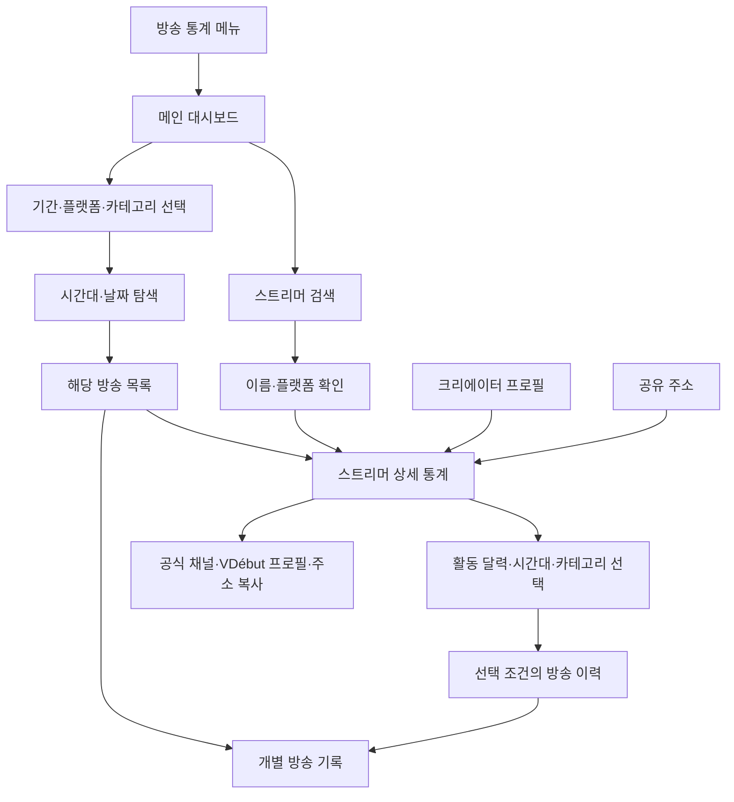

# VDébut 방송 통계 대시보드 개선 기획 보고서

작성일: 2026-10-05  
대상: 메인 대시보드 · 검색 결과 · 스트리머 상세 대시보드 · 개별 방송 기록  
문서 성격: 현재 구현을 기준으로 한 다음 개선 단계의 제품 기획  
구현 기준: [현재 구현 내역](./04_방송활동_대시보드.md)

이 보고서는 방송 활동 중심으로 합의한 방향을 따른다. 기존 01_IA·02_PRD의 실시간 시청 규모·랭킹 중심 구성과 구분하며, 이후 개선 작업의 기준 문서로 사용한다. 아래의 개선 계획은 추가 구현이 필요한 제안이며, 현재 기능은 별도로 표시한다.

## 1. 목적

### 1.1 서비스가 답할 질문

VDébut 방송 통계는 다음 두 질문에 답한다.

1. **다른 방송자들은 언제, 어떤 방송을 했는가?**
2. **검색한 스트리머는 지금까지 어떻게 방송했는가?**

메인은 방송 활동의 전체 흐름을 보여준다. 스트리머 상세는 선택한 채널의 활동 시간과 콘텐츠, 회차별 기록을 보여준다. 사용자는 전체 흐름을 확인한 뒤 관심 있는 시간·카테고리·스트리머의 실제 방송 기록까지 찾아갈 수 있어야 한다.

### 1.2 이용자와 이용 목적

| 이용자 | 들어오는 이유 | 확인할 정보 | 다음 행동 |
| --- | --- | --- | --- |
| 데뷔 준비생 | 다른 방송자들의 방송 시간과 콘텐츠를 참고 | 요일·시간대별 활동, 카테고리 분포 | 관심 조건의 방송과 스트리머 조회 |
| 신입·활동 중 스트리머 | 자신의 채널 또는 참고할 채널의 활동 확인 | 방송일, 시작 시각, 방송 시간, 콘텐츠 변화 | 기간을 바꾸어 회고하거나 개별 기록 확인 |
| 팬·시청자 | 관심 스트리머의 방송 활동 확인 | 활동 달력, 최근 방송 제목·카테고리 | 채널 방문, 프로필 조회, 통계 주소 공유 |

‘개인 대시보드’는 내부 기획 명칭이다. **로그인한 사용자 본인의 화면을 뜻하지 않는다.** 서비스 화면에서는 `○○○ 방송 통계` 또는 `상세 통계`로 표시한다. 검색과 공개 통계 조회에 로그인·채널 등록을 요구하지 않는다.

### 1.3 VDébut 이용 흐름과의 연결

데뷔 일정에서 크리에이터를 발견한 사용자는 프로필에서 방송 통계로 이동한다. 통계에서 크리에이터를 찾은 사용자는 프로필과 공식 채널로 이동한다. 데뷔 이후의 활동도 계속 확인할 수 있도록 일정·프로필·통계를 연결한다.

## 2. 목표

### 2.1 제품 목표

| 목표 | 원하는 사용자 경험 | 완료 기준 |
| --- | --- | --- |
| 전체 활동 이해 | 첫 화면에서 기간·대상·활동 규모를 파악 | 요약과 주요 차트에 같은 조회 조건 적용 |
| 특정 채널 조회 | 이름과 플랫폼을 확인하고 상세로 이동 | 자동완성·검색 결과에서 채널 ID로 동일 대상 조회 |
| 기록까지 탐색 | 차트에서 발견한 특징을 실제 방송으로 확인 | 시간대·카테고리·날짜 선택이 방송 목록으로 연결 |
| 활동 회고 | 언제 방송했고 어떤 콘텐츠를 했는지 이해 | 달력·시작 시간·콘텐츠 구성·회차 기록 제공 |
| 조건 유지 | 새로고침·공유·복귀 시 다시 찾지 않아도 됨 | 주소에 조건 저장, 검색 복귀·브라우저 기록 복원 |
| 수치 신뢰 | 데이터가 없는 상태를 방송하지 않은 것으로 오해하지 않음 | 0·기록 없음·조회 실패를 구분 |
| 모바일 이용 | 작은 화면에서도 검색과 상세 조회를 완료 | 페이지 가로 넘침 없이 핵심 정보·버튼 접근 |

### 2.2 성과를 확인할 지표

| 확인 지표 | 정의 | 사용 목적 |
| --- | --- | --- |
| 검색 후 상세 진입률 | 검색 결과를 본 이용 중 상세에 진입한 비율 | 결과 카드와 검색 품질 평가 |
| 차트 탐색 완료율 | 차트를 선택한 이용 중 해당 방송 목록까지 확인한 비율 | 차트와 실제 기록의 연결 평가 |
| 상세 기록 열람률 | 스트리머 상세 이용 중 개별 방송 기록을 연 비율 | 개인 화면의 실용성 평가 |
| 프로필·공식 채널 이동률 | 통계 상세에서 프로필 또는 채널로 이동한 비율 | 서비스 간 연결 평가 |
| 조회 오류·재시도 성공률 | 조회 실패와 이후 재시도 결과 | 안정성 평가 |
| 응답 시간 | 전체·개인 조회의 응답 시간 분포 | 조회 기간 확대 시 성능 평가 |

배포 후 실제 기준선을 먼저 확보하고 수치 목표를 정한다. 이벤트에는 화면 종류·동작·조회 기간 길이·플랫폼 정도를 남기며, 검색어 원문이나 불필요한 개인 정보는 수집하지 않는다. 페이지에 목표 달성률이나 검증되지 않은 점수를 노출하지 않는다.

### 2.3 이번 개선의 범위

- 기존 메뉴 안에서 전체·검색·개인·회차 탐색을 완성한다.
- 현재 제공하는 치지직·SOOP의 확인 가능한 기록을 사용한다.
- 검색 대상 범위와 과거 기록 제공 범위를 구분한다. 검색되는 채널에 반드시 과거 통계가 있는 것은 아니다.
- 시청자 수는 개별 방송 기록의 보조 정보로 다룬다.
- 플랫폼 전체 채널을 수집한 것이 확인되기 전에는 확인된 채널의 합계를 플랫폼 전체 규모라고 표현하지 않는다.
- 이전 통계 화면의 다운로드·다른 지표는 별도 요구와 연결을 검토한다. 이번 메인·개인 탐색의 필수 조건으로 확대하지 않는다.

## 3. 예시

아래는 기능 동작을 설명하는 이용 예시다. 실제 통계 결과나 특정 방송 시간의 효과를 뜻하지 않는다.

### 예시 A. 방송 시간을 참고하려는 데뷔 준비생

1. 방송 통계 메뉴로 진입한다.
2. 최근 30일·치지직을 선택한다.
3. 시간대별 방송 현황에서 화요일 21시를 선택한다.
4. 해당 시간에 확인된 방송 목록과 카테고리별 구성을 살펴본다.
5. 소통 카테고리로 좁힌다.
6. 목록의 스트리머를 선택해 상세 통계와 방송 이력을 확인한다.

사용자는 방송이 많이 열린 시간을 참고한다. 화면은 이를 ‘방송 성공 가능성이 높은 시간’으로 해석하거나 추천하지 않는다.

### 예시 B. 자신의 방송 활동을 돌아보는 스트리머

1. 이름으로 검색한다.
2. 검색 결과에서 이름과 플랫폼을 확인해 자신의 채널을 선택한다.
3. 최근 30일의 방송일 수·방송 횟수·시간을 확인한다.
4. 활동 달력에서 궁금한 날짜를 선택한다.
5. 그날의 방송 제목·카테고리·시간을 확인한다.
6. 회차 상세를 열거나 다른 기간으로 바꾸어 활동 흐름을 살펴본다.

본인 인증 없이 공개 기록을 조회하는 흐름이다. 서비스 화면에서는 ‘내 통계’라는 표현을 사용하지 않는다.

### 예시 C. 데뷔 일정에서 넘어온 팬

1. 데뷔 일정에서 크리에이터 프로필을 연다.
2. 프로필의 방송 통계를 선택한다.
3. 해당 채널 상세로 바로 이동한다.
4. 최근 활동을 보고 공식 채널로 이동하거나 통계 주소를 공유한다.

프로필에서 이미 선택한 채널을 통계 화면에서 다시 검색하게 하지 않는다. 활동 채널이 여럿이면 채널별 통계 링크를 제공한다.

### 예시 D. 검색은 되지만 방송 기록이 없는 채널

1. 검색 결과에서 채널을 선택한다.
2. 프로필·플랫폼·공식 채널 링크는 유지한다.
3. `선택한 기간의 방송 기록이 없습니다.`를 표시한다.
4. 다른 기간 조회·공식 채널 이동을 제공한다.

없는 기록을 임의의 숫자로 채우거나 조회를 위해 채널 등록을 요구하지 않는다.

## 4. 페이지 구성과 기능·동작 원리

### 4.1 정보 구조

```text
방송 통계
├─ 전체 통계 /analytics
│  ├─ 스트리머 검색
│  ├─ 조회 기간 · 플랫폼 · 카테고리
│  ├─ 활동 요약
│  ├─ 시간대별 방송 현황
│  ├─ 카테고리별 방송 통계
│  ├─ 방송 활동 추이
│  └─ 방송 이력 → 채널 상세 / 방송 기록
├─ 검색 결과 /analytics?search=검색어
│  ├─ 검색어 수정
│  ├─ 이름 · 플랫폼 · 프로필
│  └─ 상세 통계 → 채널 고유 주소
└─ 스트리머 상세 /analytics/streamer/채널키
   ├─ 채널 프로필 · 공식 채널 · VDébut 프로필 · 주소 복사
   ├─ 조회 기간 · 카테고리
   ├─ 활동 요약
   ├─ 시간대별 방송 현황
   ├─ 카테고리별 방송 통계
   ├─ 방송 활동 달력
   └─ 방송 이력 → 개별 방송 기록
```

회차 상세는 초기 단계에 목록 안에서 펼친다. 나중에 시간대별 시청자 변화·콘텐츠 변경 기록이 충분히 확보되면 개별 방송의 독립 주소를 추가한다.

### 4.2 메인 대시보드

| 순서 | 영역 | 보여줄 정보 | 사용자 동작 | 현재 → 개선 |
| --- | --- | --- | --- | --- |
| 1 | 제목·검색 | 방송 통계, 검색창 | 검색 또는 전체 현황 확인 | 구현됨. 검색 오류·대기 상태 보강 |
| 2 | 공통 조회 조건 | 기간·플랫폼·카테고리·적용 조건 | 조회 범위 설정·해제 | 기간·플랫폼 구현됨. 카테고리 선택기·조건 초기화 추가 |
| 3 | 활동 요약 | 활동 채널·방송 횟수·총 방송 시간·방송 카테고리 수 | 활동 규모 파악 | 현재 ‘활동 스트리머’ 단위를 수정하고 중복되는 메인 방송일 수 카드 교체 |
| 4 | 시간대별 방송 현황 | 요일×시간, 평균 방송 채널·방송 시작 횟수 | 시간대를 선택해 관련 기록 조회 | 표시·지표 전환 구현됨. 시간대 선택과 목록 연결 추가 |
| 5 | 카테고리별 방송 통계 | 방송 시간·횟수·비중 | 카테고리 선택·전체 목록 조회 | 상위 8개·필터 구현됨. 전체 카테고리 탐색과 선택 상태 개선 |
| 6 | 방송 활동 추이 | 날짜별 방송 횟수, 선택 날짜 | 날짜 선택·관련 기록 조회 | 차트 표시 구현됨. 날짜 선택 추가 |
| 7 | 방송 이력 | 채널·제목·카테고리·시작·방송 시간 | 채널 상세·회차 상세 조회 | 최근 200개 구현됨. 페이지 단위 조회·선택 조건 표시 추가 |
| 8 | 통계 안내 | 집계 대상·시간 기준·기록 범위 | 필요한 경우 펼쳐 확인 | 구현됨. 짧은 범위 정보는 상단으로 이동 |

**핵심 개선:** 첫 화면은 검색과 전체 동향을 동시에 제공한다. 특정 시간이나 카테고리를 선택한 이후에는 선택 조건과 해당 방송 목록이 가까이 있어야 한다. 사용자가 긴 페이지를 훑으며 결과를 찾아야 하는 구조를 줄인다.

### 4.3 검색 결과

| 정보 | 표시 원칙 |
| --- | --- |
| 이름·사진 | 선택하려는 채널을 식별하는 중심 정보 |
| 플랫폼 | 동명이인과 여러 플랫폼의 같은 활동명을 구분 |
| 방송 상태 | 실제 현재 상태가 확인될 때만 방송 중 표시 |
| 상세 통계 | 카드의 주 행동. 채널 고유 ID로 이동 |
| 결과 정렬 | 이름 일치도 우선. 플랫폼 필터 제공 |
| 빈 결과·오류 | 결과 없음과 조회 실패를 구분하고 검색어 수정·재시도 제공 |

팔로워·시청자 수를 기본 정렬로 사용하지 않는다. 사용자는 원하는 사람을 찾으러 온 것이므로 이름 일치도와 플랫폼 확인이 먼저다. 검색 결과 카드에서 긴 분석·차트·방송 이력을 펼치지 않는다.

### 4.4 스트리머 상세 대시보드

| 순서 | 영역 | 보여줄 정보 | 사용자 동작 | 현재 → 개선 |
| --- | --- | --- | --- | --- |
| 1 | 복귀·프로필 | 이름·플랫폼·공식 채널·프로필·주소 복사 | 이전 결과 복귀·외부 이동·공유 | 구현됨. 검색 스크롤·필터 상태까지 복원 |
| 2 | 조회 조건 | 기간·카테고리 | 활동 범위 설정 | 기간 구현됨. 카테고리 선택과 조건 해제 보강 |
| 3 | 활동 요약 | 방송일 수·방송 횟수·총 방송 시간·평균 방송 시간 | 전체 활동 규모 확인 | 구현됨. 시간 집계 기준·불완전 기록 표시 보강 |
| 4 | 시간대별 방송 현황 | 방송 시작 횟수·방송 활동 비율 | 주된 활동 시간을 확인하고 회차로 이동 | 기본 표시 구현됨. 선택 시간대와 목록 연결 추가 |
| 5 | 카테고리별 방송 통계 | 콘텐츠별 시간·횟수·비중 | 주 콘텐츠와 해당 방송 확인 | 구현됨. 전체 카테고리·변화 조회 개선 |
| 6 | 방송 활동 | 월별 달력·날짜별 방송 횟수·시간 | 특정 날짜의 방송 확인 | 연속 날짜 달력 구현됨. 월별 구획·날짜 선택 추가 |
| 7 | 방송 이력 | 제목·카테고리·시작·시간·회차 상세 | 기록 확인 | 구현됨. 날짜 선택과 목록 연결·페이지 조회 추가 |

개인 화면은 로그인·관리 화면처럼 구성하지 않는다. 이름과 플랫폼을 페이지 상단에 계속 식별할 수 있게 두고, 프로필 편집·등록 기능은 이 화면의 핵심 행동에 포함하지 않는다.

### 4.5 주요 기능과 동작 원리

| 기능 | 입력·동작 | 처리 원리 | 결과 |
| --- | --- | --- | --- |
| 스트리머 검색 | 이름 입력 | 등록 채널과 플랫폼 검색 결과를 채널 키로 중복 제거 | 이름·플랫폼별 채널 결과 |
| 상세 조회 | 채널 선택 | 채널 고유 ID를 주소에 저장하고 기록을 조회 | 해당 채널의 대시보드 |
| 공통 필터 | 기간·플랫폼·카테고리 적용 | 같은 조건으로 요약·차트·활동 기록 집계 | 일관된 전체·개인 통계 |
| 시간대 탐색 | 요일·시각 선택 | 활동 지표는 그 시간에 실제 확인된 기록, 시작 지표는 그 시간에 시작한 회차를 조회 | 선택 시간대의 방송 목록 |
| 카테고리 탐색 | 카테고리 선택 | 공통 조건에 반영하고 해당 구간·방송 기록을 조회 | 해당 콘텐츠의 통계·이력 |
| 날짜 탐색 | 추이 또는 달력 날짜 선택 | 전체 기간을 유지한 채 해당 날짜의 확인 기록을 추가 조회 | 그날의 방송 이력 |
| 회차 상세 | 상세 기록 선택 | 플랫폼·채널·방송 ID로 회차 식별 | 해당 방송의 실제 기록 |
| 조건 복원 | 공유·새로고침·뒤로가기 | 주소의 채널·기간·카테고리·선택 조건을 복원 | 동일한 조회 화면 |
| 추가 목록 | 더 보기·페이지 이동 | 고정된 정렬과 다음 조회 위치를 사용해 기록 추가 | 이전 회차까지 탐색 |

시간대 탐색에서 방송 최초·최근 기록 사이의 모든 시간을 활동했다고 추정하지 않는다. 해당 시각의 실제 기록과 조회 결과가 일치해야 한다.

### 4.6 지표 정의

| 화면 지표 | 정의 | 주의할 집계 조건 |
| --- | --- | --- |
| 활동 채널 | 기간 중 방송이 확인된 플랫폼·채널 키의 고유 수 | 같은 사람이 여러 플랫폼에 있으면 채널별 집계. 사람 수로 표현하지 않음 |
| 방송 횟수 | 기간에 확인된 플랫폼·채널·방송 ID 조합 수 | 자정을 넘긴 방송도 기간 전체에서는 한 회차 |
| 방송일 수 | 해당 채널의 방송 기록이 확인된 날짜 수 | 개인 화면의 활동 지표 |
| 총 방송 시간 | 확인된 연속 기록 구간의 시간 합계 | 실제 종료 시각이 없는 방송에 종료 시각을 만들어 넣지 않음 |
| 평균 방송 시간 | 동일한 시간 집계 기준의 방송 시간 합계 ÷ 대상 회차 수 | 단일 기록·불완전 회차 처리 기준을 먼저 확정하고 분모 표시 |
| 방송 카테고리 수 | 선택 범위에서 확인된 카테고리 고유 수 | ‘미제공’ 항목은 별도 표시. 플랫폼 간 이름만으로 무조건 병합하지 않음 |
| 시간대별 방송 활동 | 같은 요일·시각의 유효한 수집 회차에서 확인한 평균 채널 수 | 실패 회차를 0으로 넣지 않음. 포함 플랫폼 수와 범위 확인 |
| 개인 방송 활동 | 해당 시간대 유효 기록 중 채널 방송이 확인된 비율 | 날짜·분모 범위와 해당 채널이 조회 대상이었는지 확인 |
| 방송 시작 | 실제 시작 시각이 확인되고 선택 범위에서 시작한 회차 수 | 최초 수집 시각을 시작 시각으로 대체하지 않음 |
| 카테고리별 방송 시간 | 카테고리별 확인 구간의 시간 합계 | 방송 중 카테고리 변경과 자정 경계를 반영 |
| 카테고리별 방송 횟수 | 해당 카테고리가 확인된 고유 방송 수 | 한 회차에 여러 카테고리가 있어 합계가 전체 회차 수보다 클 수 있음 |

**기존 구현에서 바로 정리할 사항:** 현재 ‘활동 스트리머’ 카드의 실제 단위는 채널이다. 명칭과 단위를 `활동 채널 · 개`로 맞춘다. 전체 화면의 방송일 수는 기록 제공 범위와 겹치므로 `방송 카테고리` 카드로 교체하고, 개인 화면에서는 방송일 수를 유지한다.

### 4.7 화면 상태

| 상태 | 처리 |
| --- | --- |
| 최초 로딩 | 프로필·조회 조건을 유지하고 통계 영역에 로딩 표시 |
| 조건 변경 | 새 조건의 이전 수치를 섞지 않고 차트·목록을 함께 갱신 |
| 유효한 0 | 조회 범위와 기록이 확인된 지표는 0 표시 |
| 기록 없음 | 확인할 기록이 없으면 `—` 또는 기록 없음 표시 |
| 부분 기록 | 제공되는 부분은 표시하고 영향받는 지표에 짧은 안내 |
| 조회 실패 | 오류와 다시 시도 제공. 빈 결과로 취급하지 않음 |
| 검색 결과 없음 | 검색어 확인·수정 유도 |
| 기록 없는 검색 채널 | 프로필과 채널 이동 유지, 기간 변경 제공 |
| 잘못된 주소·조건 | 지원하지 않는 조건을 알려 전체 통계로 이동 제공 |

## 5. 플로우

### 5.1 전체 사용자 흐름



### 5.2 공통 필터와 목록 탐색의 구분

| 조건 | 적용 범위 | 주소 저장 | 해제 방법 |
| --- | --- | --- | --- |
| 기간 | 요약·모든 차트·달력·목록 | from·to | 기간 다시 선택 |
| 플랫폼 | 전체 대시보드 전체 | platform | 전체 플랫폼 |
| 카테고리 | 해당 범위의 요약·시간대·활동·목록 | category | 전체 카테고리 |
| 시간대 | 관련 방송 목록과 선택 영역 | weekday·hour·timeMetric 추가 | 시간대 선택 해제 |
| 활동 날짜 | 해당 날짜의 방송 목록 | day 추가 | 날짜 선택 해제 |
| 회차 | 열린 회차 기록 | stream 추가 | 상세 닫기 |

시간대와 날짜는 기록을 더 살펴보기 위한 지역 선택이다. 전체 조회 기간과 요약 수치는 유지한다. 사용자가 공통 조건을 바꾸면 지역 선택이 여전히 유효한지 확인하고, 새 범위 밖의 날짜 등은 해제한다.

첫 개선 단계에서는 **시간대 또는 날짜 중 하나를 선택**하도록 한다. 새 선택은 이전 지역 선택을 대체해 조건이 과도하게 겹치는 것을 막는다. 카테고리·플랫폼은 공통 조건과 함께 사용할 수 있다.

### 5.3 시간대에서 방송 목록으로 이동

1. 셀에 마우스를 올리거나 초점을 두면 요일·시간·지표가 표시된다.
2. 클릭·Enter로 시간대를 선택한다.
3. 선택 표시와 `화요일 21시` 조건을 표시한다.
4. 방송 목록에 해당 조건을 적용하고 목록 제목·결과 수를 갱신한다.
5. PC는 목록으로 이동하거나 인접한 결과 영역을 열고, 모바일은 결과 위치로 이동한다.
6. 선택을 해제하면 원래 범위의 목록으로 돌아온다.

방송 활동과 방송 시작은 다른 목록을 만들므로 선택 조건에 지표도 포함한다. 실제 조회가 완료되기 전에는 이전 목록을 새 조건의 결과처럼 표시하지 않는다.

### 5.4 활동 달력에서 회차 기록으로 이동

1. 사용자는 선택 기간의 월별 활동 달력을 본다.
2. 날짜를 선택한다.
3. 달력과 전체 요약은 유지한다.
4. `10월 5일 방송 이력` 영역에 해당 날짜 기록을 표시한다.
5. 회차를 펼쳐 제목·카테고리·방송 시작·기록 구간·시간을 확인한다.
6. 날짜 선택 해제 또는 다른 날짜 선택으로 탐색을 이어간다.

자정을 넘긴 방송은 기록이 확인된 각각의 날짜에서 찾을 수 있지만, 기간 전체 방송 횟수는 중복 계산하지 않는다.

### 5.5 복귀·공유 흐름

- 메인에서 상세로 들어오면 `전체 통계`로 복귀한다.
- 검색에서 들어오면 `검색 결과`로 복귀하며 검색어·플랫폼 선택·스크롤 위치를 유지한다.
- 프로필에서 들어오면 `프로필`로 돌아갈 수 있는 링크를 제공한다.
- 공유 주소로 직접 들어오면 전체 통계와 검색을 제공한다. 존재하지 않는 이전 화면으로 돌아간다고 표시하지 않는다.
- 주소 복사는 채널 ID와 조회 조건을 포함한다. 이름은 표시 보조값이며 조회 대상을 결정하지 않는다.

## 6. 상세 계획

### 6.1 현재 구현과 개선 우선순위

| 우선순위 | 개선 항목 | 필요한 이유 | 구현 내용 | 완료 기준 |
| --- | --- | --- | --- | --- |
| P0 | 지표 단위·범위 정리 | 사람 수·채널 수, 플랫폼 전체·일부 기록 혼동 방지 | 활동 채널 명칭·단위, 메인 카드 교체, 집계 범위 표시 | 모든 카드의 명칭·단위가 실제 집계와 일치 |
| P0 | 기록 상태 보강 | 빈 기록과 실패, 유효한 0을 구분 | 플랫폼·날짜별 유효 회차 및 누락 상태 제공 | 누락 구간에 0이 표시되지 않음 |
| P0 | 공통 필터 완성 | 선택 조건을 쉽게 이해하고 해제 | 카테고리 선택기, 적용 조건, 조건 초기화 | 동일 조건으로 요약·차트·목록 갱신 |
| P1 | 시간대 → 목록 | 차트를 실제 방송 탐색에 활용 | 요일·시간·지표별 필터와 조회 API | 활동·시작 지표에 맞는 정확한 기록 반환 |
| P1 | 날짜 → 목록 | 달력을 회고 기능으로 완성 | 날짜 선택·당일 기록·선택 해제 | 전체 기간 유지, 선택 날짜의 방송만 표시 |
| P1 | 검색·복귀 개선 | 원하는 채널을 쉽게 선택하고 탐색을 이어감 | 플랫폼 필터, 시간 초과·재시도, 결과 상태·스크롤 복원 | 동명이인 선택과 브라우저 복귀 검증 |
| P1 | 달력·모바일 개선 | 30·90일 조회의 가독성 확보 | 월별 구획·이동, 시간대 보기, 모바일 방송 카드 | 320px에서도 제목·시간·상세 버튼 접근 |
| P2 | 전체 카테고리·과거 이력 | 상위 항목·최근 200개 이후도 조회 | 카테고리 전체 보기, 안정적인 목록 페이지 조회 | 전체 집계와 목록 범위가 명확히 구분 |
| P2 | 콘텐츠 변화 | 기간 내 방송 구성이 어떻게 변했는지 확인 | 주별·월별 카테고리 시간 변화 | 동일 기간·단위로 활동 변화를 확인 |
| P3 | 이전 기간 비교 | 방송 습관 변화의 비교 제공 | 동일 길이 이전 기간과 나란히 조회 | 기록 범위가 충분한 경우에만 비교·증감 표시 |

P0·P1을 우선 완료한다. 기간 비교와 독립 회차 상세는 기록 품질과 탐색 기능이 안정된 이후에 진행한다.

### 6.2 데이터·API 개선

| 항목 | 현재 | 추가 계획 |
| --- | --- | --- |
| 전체·개인 조회 | `/api/analytics/activity`에 기간·플랫폼·채널·카테고리 | 현재 계약 유지, 집계 대상과 지표별 기록 상태 추가 |
| 시간대 목록 | 집계 히트맵, 별도 시간 필터 없음 | weekday·hour·timeMetric으로 실제 회차를 조회 |
| 날짜 목록 | 일별 집계와 기간 전체 회차 | day 선택으로 당일 기록을 별도 조회 |
| 카테고리 | 이름 기준 집계, 상위 표시 | 플랫폼·카테고리 ID의 안정적인 키, 전체 선택 목록 |
| 회차 기록 | 최근 200개와 플랫폼·채널·방송 ID | 고유 회차 키, 다음 조회 위치, 중복 없는 페이지 정렬 |
| 방송 시간 | 15분 이하 연속 확인 구간 합산 | 종료 정보가 실제 제공되면 구분 저장, 자정 경계 분할, 단일 기록·누락 상태 명시 |
| 기록 범위 | 최초·최근 시각·기록일·부분 회차 수 | 플랫폼·날짜·지표별 유효 분모와 실제 기록 제공 범위 |
| 프로필 연결 | 대표 채널의 방송 통계 링크 | 여러 활동 채널의 채널별 통계 링크 |

집계 대상이 다른 플랫폼을 합산할 때는 각 범위를 함께 유지한다. 일부 플랫폼 회차가 누락된 시각을 정상적인 합산값으로 처리하지 않는다. 전체 기간 요약은 회차 목록 페이지 제한과 분리한다.

조회 결과는 제한된 시간 동안 재사용할 수 있게 하되, 플랫폼·기간·채널·카테고리·지역 선택을 모두 구분한다. 개인 회차·카테고리별 기록을 원본 전체 배열로 내려보내 화면에서 임의 계산하는 방식은 피한다. 실제 기록 조회와 집계 규칙을 서버에서 일치시킨다.

### 6.3 화면 배치

**PC 메인**

```text
제목·짧은 설명                         스트리머 검색
기간·플랫폼·카테고리·적용 조건·집계 범위
활동 채널 | 방송 횟수 | 총 방송 시간 | 방송 카테고리
시간대별 방송 현황                     카테고리별 방송 통계
방송 활동 추이
선택 조건                              선택 해제
방송 이력 → 스트리머 상세 / 회차 기록
통계 안내
```

**PC 스트리머 상세**

```text
복귀 링크
프로필·이름·플랫폼                  채널·프로필·주소 복사
기간·카테고리·적용 조건
방송일 수 | 방송 횟수 | 총 방송 시간 | 평균 방송 시간
시간대별 방송 현황                  카테고리별 방송 통계
월별 방송 활동 달력
선택 날짜·시간대                    선택 해제
방송 이력 → 회차 기록
통계 안내
```

**모바일**

- 첫 화면에서 검색과 현재 조회 조건을 바로 찾을 수 있게 한다.
- 상세는 이름·플랫폼·복귀를 먼저 보여주고 채널 이동·공유를 이어서 배치한다.
- 요약은 2×2 카드로 표시한다.
- 시간대 현황은 요일 선택+24시간 보기 또는 내부 가로 이동을 제공한다. 선택한 시간과 결과가 화면 밖으로 사라지지 않게 한다.
- 카테고리·활동 추이·달력은 한 열로 배치한다.
- 방송 이력은 기본 정보를 카드로 표시해 제목과 상세 버튼을 가로 스크롤 없이 확인하게 한다.
- 선택 결과가 멀리 있는 경우 결과 위치로 이동하는 버튼을 제공한다. 키보드·화면 읽기 도구의 초점도 결과 제목으로 연결한다.

### 6.4 구현 순서와 산출물

| 단계 | 작업 | 산출물 |
| --- | --- | --- |
| 1 | 지표·단위·범위·기록 상태 확정 | 지표 정의와 API 계약 |
| 2 | 공통 조회 조건·선택 상태·복귀 설계 | 주소 조건과 상태 전이 명세 |
| 3 | 메인 시간대·카테고리·추이 → 목록 연결 | 메인 대시보드 개선 |
| 4 | 개인 달력·시간대 → 회차 연결 | 개인 대시보드 개선 |
| 5 | 검색 결과·다중 채널 프로필·공유 연결 | 진입·복귀 흐름 완성 |
| 6 | 모바일 목록·월별 달력·전체 카테고리·목록 페이지 | 작은 화면과 장기 기록 조회 개선 |
| 7 | 집계·동작·접근성·성능 확인 | 검증 기록과 배포 체크 결과 |

### 6.5 검증·출시 기준

- 동명이인·동일 활동명의 다른 플랫폼을 채널 ID로 구분한다.
- 메인·검색·프로필·공유 주소의 네 진입 경로를 검증한다.
- 기간·플랫폼·카테고리와 시간대·날짜 선택의 적용 범위가 일치한다.
- 자정을 넘는 방송, 여러 카테고리의 방송, 수집 공백, 단일 기록 회차를 검증한다.
- 방송 시작 목록은 실제 시작 시각과 일치하고, 활동 목록은 실제 확인 기록과 일치한다.
- 날짜별 회차 합계와 기간 전체의 고유 회차 수가 달라질 수 있음을 집계 정의에 맞게 처리한다.
- 유효한 0·기록 없음·부분 기록·API 오류를 각각 확인한다.
- 전체 집계가 목록 페이지 제한으로 바뀌지 않는다.
- 7·30·90일과 기록이 많은 채널에서 응답 시간과 DB 조회량을 측정한다.
- 320·390·768·1440px 화면에서 핵심 행동을 완료한다.
- 검색·차트 선택·달력·상세 기록을 키보드로 사용할 수 있다.
- 새 API와 인덱스는 개발 환경에서 확인한 뒤 운영 배포 순서를 정한다. 현재 구현은 운영 배포 전 상태다.

## 7. 텍스트 정리

### 7.1 문체

- 제목·메뉴·지표는 짧은 명사형을 사용한다.
- 설명은 담백한 존댓말로 기능과 조회 대상을 말한다.
- ‘개인 대시보드’, ‘내 통계’ 대신 스트리머 이름과 통계 제목을 사용한다.
- ‘유입 기회’, ‘성장 리포트’, ‘성공 점수’, ‘최적 시간’처럼 실제 집계보다 큰 의미를 약속하는 표현을 사용하지 않는다.
- ‘스냅샷’, ‘캐시’, ‘알고리즘’ 등 구현 용어는 화면 설명에 넣지 않는다.
- 집계 범위와 시간 기준은 짧게 표시하고 상세 정의는 통계 안내에서 제공한다.

### 7.2 화면 제목·설명

| 위치 | 확정 또는 권장 문구 |
| --- | --- |
| 메뉴·메인 제목 | 방송 통계 |
| 메인 설명 | 플랫폼별 방송 현황과 시간대별 활동, 카테고리 통계를 확인하세요. |
| 전체 화면 탐색 | 전체 통계 |
| 검색창 | 스트리머 검색 |
| 검색 결과 제목 | “검색어” 검색 결과 |
| 검색 결과 행동 | 상세 통계 |
| 스트리머 상세 제목 | ○○○ 방송 통계 |
| 상세 설명 | 방송 이력과 활동 시간, 카테고리별 통계를 확인하세요. |
| 시간대 영역 | 시간대별 방송 현황 |
| 시간대 지표 | 방송 활동 / 방송 시작 |
| 전체 활동 설명 | 요일·시간대별 평균 방송 채널 수 |
| 개인 활동 설명 | 요일·시간대별 방송 활동 비율 |
| 시작 지표 설명 | 요일·시간대별 방송 시작 횟수 |
| 카테고리 영역 | 카테고리별 방송 통계 |
| 카테고리 지표 | 방송 시간 / 방송 횟수 |
| 추이 영역 | 방송 활동 추이 |
| 개인 달력 | 방송 활동 |
| 회차 목록 | 방송 이력 |
| 선택 날짜 목록 | 10월 5일 방송 이력 |
| 선택 시간대 목록 | 화요일 21시 방송 이력 |
| 안내 | 통계 안내 |

### 7.3 지표·필터·버튼

| 구분 | 문구 |
| --- | --- |
| 메인 요약 | 활동 채널 · 방송 횟수 · 총 방송 시간 · 방송 카테고리 |
| 개인 요약 | 방송일 수 · 방송 횟수 · 총 방송 시간 · 평균 방송 시간 |
| 기간 | 최근 7일 · 최근 30일 · 최근 90일 |
| 직접 조회 | 시작일 · 종료일 · 조회 |
| 플랫폼 | 전체 플랫폼 · 치지직 · SOOP |
| 카테고리 | 전체 카테고리 · 카테고리 선택 |
| 적용 조건 | 선택 조건 · 조건 초기화 · 선택 해제 |
| 복귀 | 전체 통계 · 검색 결과 · 프로필 |
| 상세·이동 | 상세 기록 · 닫기 · 채널 바로가기 · VDébut 프로필 |
| 추가 조회 | 방송 이력 더 보기 · 전체 카테고리 |
| 공유 | 주소 복사 |
| 재시도 | 새로고침 · 다시 시도 |

### 7.4 상태·짧은 안내

| 상황 | 문구 |
| --- | --- |
| 통계 로딩 | 방송 통계를 불러오는 중입니다. |
| 검색 로딩 | 검색 중… |
| 검색 없음 | 검색 결과가 없습니다. |
| 검색 도움 | 스트리머 이름을 확인하거나 다른 검색어를 입력하세요. |
| 기록 없음 | 선택한 기간의 방송 기록이 없습니다. |
| 빈 기간의 다음 행동 | 다른 기간을 선택해 확인하세요. |
| 조회 실패 | 방송 통계를 불러오지 못했습니다. 다시 시도해 주세요. |
| 시간 초과 | 조회 시간이 길어지고 있습니다. 다시 시도해 주세요. |
| 부분 기록 | 일부 시간대의 기록이 없습니다. |
| 확인된 무방송 | 방송 기록 0회 — 해당 채널 조회와 무방송 상태가 확인된 경우에만 사용 |
| 날짜 미확인 | 기록 없음 |
| 지원하지 않는 조회 조건 | 조회 조건을 확인해 주세요. |
| 주소 복사 성공 | 주소를 복사했습니다. |
| 주소 복사 실패 | 주소를 복사하지 못했습니다. |
| 집계 대상 | 통계 대상: 확인된 채널 |
| 기준 시각 | 10월 5일 21:10 기준 — 실제 반환 시각 사용 |
| 시각 기준 | 한국 시각 (KST) |
| 시간 도움말 | 방송 시간은 확인된 기록 구간을 기준으로 집계합니다. |
| 시작 도움말 | 시작 시각이 확인된 방송 기준 |

상태 문구는 사용자에게 실제로 가능한 다음 행동과 함께 표시한다. 예시의 날짜·시각은 운영 수치로 고정하지 않는다.

## 8. 최종 개선 방향

현재 구현은 전체·개인 대시보드의 기본 골격과 검색·공유·기록 조회를 갖췄다. 다음 단계에서는 차트·달력을 실제 방송 탐색에 연결하고, 지표 단위와 기록 범위를 더 명확히 한다.

**전체 통계에서는 시간·카테고리·날짜에서 방송 목록으로, 개인 통계에서는 활동 달력과 시간대에서 개별 회차로 이동하는 흐름을 완성한다.** 초기 개선은 이 탐색의 완성과 데이터 해석의 정확성에 집중한다.

## 근거 자료

- [현재 구현 내역](./04_방송활동_대시보드.md)
- `frontend/src/components/analytics/ActivityDashboard.tsx`: 전체·개인·검색 상태와 화면 구성.
- `frontend/src/components/analytics/ActivityStreamerSearch.tsx`: 검색 제안과 채널 선택.
- `frontend/src/components/analytics/useBroadcastActivity.ts`: 조건별 조회와 로딩·실패 처리.
- `shared/broadcastActivity.ts`: 조회 조건과 활동 집계 응답.
- `backend/src/services/broadcastActivityService.ts`: 집계·시간대·카테고리·날짜·회차 조회.
- `frontend/src/components/profile/CreatorProfilePage.tsx`: 프로필 진입 링크.
- 사용자와 합의한 화면 문구 및 서비스 UX 원칙.

이 문서 작성에서는 서비스 코드·운영 데이터·배포 상태를 변경하지 않았다.
