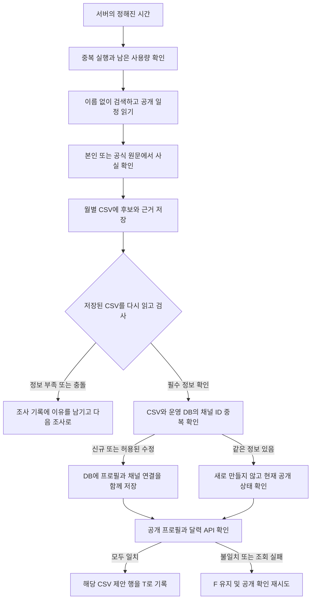

# 최종 정리 전 신규버튜버자동화 기술 문서 기록

보존일: 2026-11-13. 아래 내용은 최종 정리 직전 문서의 원문입니다. 현재 운영·개발 기준은 [신규버튜버자동화](신규버튜버자동화.md)를 따릅니다. 이 기록의 선택 대기·키 미연결·미구현 설명은 작성 시점과 구분합니다.

# 신규버튜버자동화

기술 기준서 · 운영 현황 갱신: 2026-11-13 · 서비스: VDébut

## 검색 공정 후속 구축안

**실사용 후속 기록:** [Tavily 첫 실검색 시험](tavily-pilot-2026-11-13.md)에서 로컬 시험 도구로 Basic 3회·응답 크레딧 3·결과 30개를 확인했습니다. 이는 정기 Worker 연결·배포 완료와 구분합니다. 운영 검색 설정은 바꾸지 않았고, 주요 단서 3개는 원문·고유 채널 미확인 보류이며 공개 등록은 없습니다.

**기술 선택·API·대안 비교는 [자동화 기술 제안 보고서](debut-automation-technology-review-2026-11-13.md)가 우선합니다.** 검색과 원문 확보를 분리하고, X 공식 API·OpenAI·치지직 공식 Open API·Cloudflare 처리 방식의 장단점·권한·비용·복구를 정리했습니다. 기존 X HTML 직접 조회를 일반적인 상업용 수집 해법으로 확정하지 않으며, Tavily만으로 X 단독 공지까지 완전 자동화한다고 설명하지 않습니다.

**실행 설계는 [검색·등록 공정 구축안](debut-search-process-2026-11-13.md)을 따릅니다.** SOOP 공식 일정 직접 조회와 Tavily Basic 기반 이름 없는 검색을 병행하는 설계이며, 매일 09시·21시와 월요일 10시의 검색어·미처리 대기열·회차 외부 40회·월 검색 280회·CSV·공개 확인 순서를 구체화했습니다. ChatGPT·Gemini를 매번 중복 호출하지 않습니다.

이는 아래 현재 운영 상태와 구분하는 **후속 설계**입니다. Tavily 연결부·검색 계획 저장·일반 커뮤니티 원문 처리는 아직 구현·활성화하지 않았고, 이번 문서 갱신으로 운영 설정을 바꾸지 않았습니다. 검색 업체의 키만 넣으면 전체 공정이 완성되는 구조가 아닙니다.

## 2026년 11월 13일 현재 운영 상태

**아래 1~22절은 11월 12일 설계 기준과 당시 구현 비교입니다. 이후 변경된 현재 상태는 이 표와 [실제 배포·시험 보고서](debut-pipeline-release-2026-11-13.md)가 우선합니다. 과거의 미구현 표기를 현재 상태로 재사용하지 않습니다.**

| 항목 | 현재 상태 |
| --- | --- |
| 신규 조회 예산 | 검색·원문 8회 / 고정 원천 12회 / 새 후보 12회 / 기존 재확인 8회. 총 외부 40회 유지 |
| 서버 CSV 선저장 | 구현·배포. CSV를 저장하고 다시 읽은 뒤 내용 해시가 일치해야 공개 DB 쓰기 가능 |
| 파일 보관 방식 | R2 설계 대신 기존 D1에 CSV 3종 문자열·버전·해시 보관. 별도 저장 서비스 개설 없음 |
| 새 DB 테이블 | `debut_csv_months` 현재 버전, `debut_csv_revisions` CSV 원문·해시, `debut_csv_receipts` 후보·원천·공개 내용과 CSV 버전 연결 |
| CSV 저장량 제한 | 월별 묶음 512KiB, 회차 쓰기 최대 4MiB. 과거 중간 버전은 90일 기준 정리, 현재·참조 버전 보호 |
| 중복 검사 | 공개·보조·대기·구형 채널·서버 CSV의 고유 채널 ID 대조. 저장 직전 비교·잠금·영수증 검사 |
| 소속사 출처 일괄 보류 | 제거. 실제 원문의 채널·행사 범위·일시·시간대로 판단 |
| 공개·T 처리 | 프로필·방송국·달력 일치 후 T. DB 성공·CSV 기록 실패는 재등록 없이 복구 |
| 달력 행사 유형 | 실제 운영 코드의 플랫폼 데뷔→첫 데뷔 오변환과 편집 시 유형 손실을 좁게 수정 |
| 실제 신규 시험 | 슈리리_: 공식 목록에서 새 채널 발견, 11/21 12:00 KST 플랫폼 데뷔, 공개·기본 KR 달력·CSV T 확인. 기존 441명 값 동일 |
| 키워드 웹 검색 | **서비스 선택·사용 조건 검토 대기. 활성화하지 않음.** Naver 시험 연결부만 있으며 Tavily 연결부는 미구현 |
| 검색 활성화 조건 | `SEARCH_PROVIDER=PENDING_SELECTION`, `SEARCH_STORAGE_RIGHTS_APPROVED=false` 기본 잠금. 키 보유만으로 호출하지 않음 |
| 전체 작업 한계 | 고정 공개 원천→CSV→공개 반영은 검증. 범용 키워드 검색까지 완성됐다고 보고하지 않음 |

새 구현은 [CSV 저장·복구](../backend/src/debutAutomation/csvLedger.ts), [조사 흐름](../backend/src/debutAutomation/runner.ts), [단계 예산](../backend/src/debutAutomation/network.ts), [공개 저장 보호](../backend/src/debutAutomation/store.ts), [0065 테이블 정의](../backend/migrations/0065_debut_csv_pipeline.sql)를 봅니다. 기존 13·14·26열과 최초 작성일·T/F 규칙을 유지합니다. 매일 09시·21시, 월요일 10시와 월 70회·CPU 5초·DB 예산도 유지합니다.

검색은 가격뿐 아니라 출처 저장·광고 활용 조건을 확인해야 합니다. [검색 서비스 도입 검토](search-service-review-2026-11-13.md)에 비용·이득·제약과 조사 방법을 정리했습니다. 가입·결제·외부 문의는 하지 않았습니다.

## 2026년 11월 12일 설계 기준과 당시 상태 기록

[관련 문서 안내](debut-automation-documents.md) · [11월 12일 작업 정리](work-summary-2026-11-12.md)

**만들려는 것은 ‘이름을 몰라도 신인을 찾고 → 근거를 확인하고 → CSV에 적고 → 중복이 없으면 사이트에 등록하는 자동 조사원’입니다.**

이 문서는 현재 코드와 앞으로 바꿀 설계를 함께 설명합니다. **이 문서를 작성하면서 코드 수정, 신규 조사, DB 변경, 배포는 하지 않았습니다.** 과거 시험 결과는 시험 날짜를 붙여 따로 적었습니다.

## 1. 먼저 이것만 읽어요

학교 신문에 새 친구를 소개한다고 생각하면 쉬워요.

1. 게시판에서 새 친구의 소개 글을 찾아요. 이것이 **검색**이에요.
2. 이름, 첫 방송 날짜, 방송국 주소가 맞는지 원래 글에서 확인해요. 이것이 **검증**이에요.
3. 확인한 내용을 조사 공책에 적어요. 이 공책이 **CSV**예요.
4. 우리 명단에 이미 있는지 확인해요. 없으면 사이트에 넣어요. 이 명단이 **DB**예요.
5. 소개 화면, 방송국 연결, 달력까지 확인해요. 모두 맞아야 공책에 **T**를 적어요.

컴퓨터가 꺼져 있어도 서버가 이 일을 해야 해요. 그래서 조사 공책도 내 PC만이 아니라 서버에 있어야 해요.

**소속사가 있는 신인도 조사 대상이에요. 소속사 공지는 정보를 찾는 곳 중 하나예요. 소속사를 거쳐야만 등록되는 구조가 아니에요.**

### 어려운 말은 이렇게 읽어요

| 기술 용어 | 쉬운 뜻 |
| --- | --- |
| 서버·Worker | 내 PC 대신 정해진 시간에 일하는 인터넷 컴퓨터와 작업 프로그램 |
| API | 프로그램이 ‘정보를 주세요’라고 요청하는 창구 |
| CSV | 표를 글자로 저장한 조사 공책 파일 |
| DB·D1 | 사이트가 사용하는 정보를 찾아 읽는 보관함과 그 제품 이름 |
| R2 | 서버의 파일 보관함. 현재는 연결 예정 |
| ID·키 | 같은 이름이어도 구분할 수 있게 붙인 번호·표시 |
| 파싱 | 긴 글이나 파일에서 정해진 항목을 꺼내 읽는 일 |
| 캐시 | 같은 자료를 매번 다시 받지 않도록 잠깐 보관한 사본 |
| 해시 | 내용이 바뀌었는지 확인하는 긴 지문 |
| JSON | 이름표를 붙여 여러 값을 묶는 글자 형식 |
| 바인딩 | Worker와 DB·파일 보관함을 연결해 주는 설정 |
| 배포 | 만든 프로그램을 실제 서버에서 쓰도록 올리는 일 |

**읽는 순서:** 전체 구조는 1~4절, 조사와 CSV는 5~10절, DB와 화면은 11~14절, 비용·보안·운영은 15~19절, 시험과 개발 순서는 20~22절입니다. 처음에는 1~4절과 21절만 읽어도 방향을 알 수 있습니다.

### 한 명을 찾았다고 생각해 봐요

아래 ‘예시별’은 설명용 가상 인물입니다. 실제 조사 결과가 아닙니다.

1. 서버가 `치지직 버튜버 데뷔 11월 14일`을 검색했어요. 예시별이라는 이름은 검색하기 전에는 몰랐어요.
2. 공식 소속사 공지에 ‘2026년 11월 14일 20:00 KST 첫 버튜버 데뷔’와 개인 방송국 주소가 있었어요.
3. 연결된 공식 방송국에서 고유 ID, 현재 이름, 프로필 이미지를 확인했어요. 날짜와 행사 범위도 서로 맞았어요.
4. 조사 기록에 출처를 남기고 신규 CSV에 F로 적었어요. 서버에 파일이 제대로 저장됐는지 다시 읽었어요.
5. CSV·공개 DB·심사대기 어디에도 같은 채널 ID가 없었어요. 프로필과 채널 연결을 함께 저장했어요.
6. 공개 프로필·방송국·달력의 11월 14일 20:00 표시가 모두 맞았어요. 그제야 해당 제안 행을 T로 바꿨어요.

만약 공지에 시간이 없었다면 4번에서 조사 기록만 남겨요. 시간을 만들어 넣지 않아요. 소속사가 있다는 이유로 멈추지도 않아요. 멈추는 이유는 **필수 정보가 없거나 서로 맞지 않기 때문**이에요.

## 2. 현재 어디까지 되어 있나요?

| 항목 | 현재 코드에서 확인한 상태 | 이 문서에서 정한 목표 |
| --- | --- | --- |
| PC 없이 실행 | Cloudflare 예약 실행이 있음 | 유지 |
| 이름 없는 신인 찾기 | 정해 둔 일정·시트·공지 계정을 조회함 | 검색어로 새 공지와 모르는 채널까지 발견 |
| 치지직 커뮤니티 검색 | 범용 검색·게시판 순회가 연결되지 않음 | 공개 원문을 읽을 수 있는 경로부터 연결 |
| CSV에 먼저 기록 | 미구현. 후보 D1 저장이 먼저임 | 서버 CSV 저장 성공 뒤 그 CSV를 읽어 공개 DB 반영 |
| 로컬 CSV | 조사·반영 결과를 내보낸 파일 | 서버 정본을 내려받은 사본으로 사용 |
| 중복·기존 수정 보호 | 채널 ID 대조, 저장 직전 재확인, 충돌 차단이 있음 | CSV 처리에도 같은 보호를 적용 |
| 프로필·방송국·달력 확인 | 저장 후 공개 API를 다시 확인함 | 유지하고 CSV의 T 처리와 연결 |
| 소속사 출처 | `AGENCY_NOTICE`이면 일괄 보류하는 코드가 있음 | 이 분기를 제거. 출처 종류 대신 실제 근거로 판단 |
| 비용 제한 | 회차·외부 요청·CPU·DB 작업량 제한이 있음 | 검색·CSV 저장에도 합산 적용 |

**현재 구현을 완성된 ‘웹 검색 → CSV → DB’ 자동화라고 부르면 안 됩니다.** 가장 큰 빈칸은 새 공지를 찾는 검색 연결과 서버 CSV를 실제 등록 입력으로 사용하는 부분입니다.

현재 실행 경로는 `원천 조회 → 후보 D1 저장 → 검증 → 공개 D1 저장 → 공개 API 확인`입니다. CSV는 그 뒤에 별도로 정리한 기록입니다.

앞으로의 기준 경로는 아래 그림입니다. D1에 실행 기록이나 검색 대기 주소를 남기는 것은 가능하지만, **새 프로필을 공개 DB에 넣기 전에는 반드시 해당 후보가 서버 CSV에 저장되어 있어야 합니다.**

## 3. 전체 흐름을 그림으로 봐요

아래는 **목표 설계**입니다. 아직 이 순서 전체가 배포된 것은 아닙니다.



보류는 일을 포기했다는 뜻이 아니에요. ‘무엇이 비었는지’를 적어 두고, 다음 조사 때 이어서 확인한다는 뜻이에요. 다만 공식 정보 자체가 없으면 자동으로 채울 수 없어요.

## 4. 언제, 얼마나 조사하나요?

한국시간 `Asia/Seoul`을 기준으로 합니다. 예전 대화의 월요일 09시 확대안 대신 **현재 설정인 월요일 10시**를 기준으로 통일합니다.

| 시간 | 조사할 기간 | 먼저 할 일 |
| --- | --- | --- |
| 매일 09:00 | 오늘 7일 전부터 30일 후까지 | 새 공지·공식 일정에서 후보 찾기, 어제 미완료 이어서 처리 |
| 매일 21:00 | 같은 기간 | 오늘부터 3일 후까지의 기존 일정 변경·링크·이미지 우선 확인 |
| 월요일 10:00 | 30일 전부터 90일 후까지 | 빠진 공지 찾기, 전주 등록자의 빈 소개 정보 보강 |

현재 주간 회차는 31~90일 후 일정을 후보로 보관합니다. 현재 공개 기준인 30일 이내와 구분합니다. 주간에 다 처리하지 못한 후보는 일일 회차로 넘깁니다.

서버 예약은 세계 공통 시간인 UTC로 적습니다. 한국시간은 UTC보다 9시간 빠릅니다.

```text
0 0 * * *      = 매일 한국시간 09:00
0 12 * * *     = 매일 한국시간 21:00
0 1 * * MON    = 월요일 한국시간 10:00
```

예를 들어 2026-11-12 일일 조사의 기간은 11월 5일~12월 12일입니다. ‘이 기간 전체를 정했다’는 말과 ‘모든 출처를 빠짐없이 읽었다’는 말은 다릅니다. 한도 때문에 못 읽은 날짜와 출처는 따로 남깁니다.

## 5. 이름을 모르는 사람을 어디서 찾나요?

### 5-1. 현재 연결되어 있는 출처

| 출처 | 실제 주소 | 얻을 수 있는 것과 한계 |
| --- | --- | --- |
| SOOP 웰컴버추얼 | [공식 일정](https://welcomevirtual.sooplive.com/) | 기간별 이름·채널·플랫폼 일정. 생애 첫 버튜버 활동과 같다고 단정하지 않음 |
| 기존 공개 커뮤니티 시트 | [공개 CSV](https://docs.google.com/spreadsheets/d/1SEcOZAhMqFLUW7bxSsBkWK0UriMD3fD82xXX2HrUf38/export?format=csv&gid=1884409648) | 후보 이름·날짜·링크. 본인 원문 확인이 추가로 필요 |
| X 데뷔 공지 계정 | [VtuberDebutBot](https://x.com/VtuberDebutBot), [KRVtubefollower](https://x.com/KRVtubefollower), [vvw_kr](https://x.com/vvw_kr) | 공개 페이지에서 게시물 주소 발견. 재게시만으로 확정하지 않음 |
| 소속사 공식 공지 | [카론 유니버스](https://www.charonuniverse.com/notice/) | 데뷔 공지·멤버·연결 채널. 소속사라는 이유로 제외하면 안 됨 |
| 공식 그룹 X | [레버니아](https://x.com/revernia_kr) | 공식 멤버와 채널 발견. 그룹 행사 날짜를 개인 데뷔일로 옮기지 않음 |

SOOP 일정 수집에 사용하는 실제 요청 형식은 다음과 같습니다. `{시작일}` 등에 날짜를 넣습니다.

```text
https://welcomevirtual.sooplive.com/api/api.php?work=getScheduleList&startDate={시작일}&endDate={종료일}
```

이 주소는 공개 일정 화면이 사용하는 내부 응답입니다. 상업적 이용권이 보장된 정식 개발자 API라고 표현하지 않습니다. 공개 접근 가능 여부와 재사용 허용 여부는 구분합니다.

### 5-2. 추가해야 할 검색 방법

**현재 미구현인 목표입니다.** 사람 이름을 검색어에 넣지 않고 다음 조합을 만듭니다.

```text
치지직 버튜버 데뷔 2026 11월
치지직 버츄얼 첫 방송 11월 12일
SOOP 버튜버 데뷔 11월 13일
숲 버츄얼 첫 방송 11월 14일
site:x.com 치지직 "데뷔" "11월"
site:x.com 치지직 "첫 방송" "11/12"
site:game.naver.com/lounge/chzzk "데뷔"
site:sooplive.co.kr "버츄얼" "데뷔"
site:sooplive.com "버튜버" "첫 방송"
```

검색 결과는 ‘어디로 가면 원문이 있는지 알려주는 표지판’입니다. 결과 요약에 적힌 날짜를 그대로 DB에 넣지 않습니다. 실제 글을 열고 본문·작성자·게시 시각·방송국 링크를 확인합니다.

치지직 커뮤니티의 시작 주소는 [치지직 라운지 게시판](https://game.naver.com/lounge/chzzk/board)입니다. 이 페이지는 브라우저에서 글을 불러오는 방식이므로, 서버가 첫 HTML만 읽으면 게시글을 못 볼 수 있습니다. **시작 주소를 안다는 것만으로 게시판 자동 수집이 구현된 것은 아닙니다.** 공개 검색에 잡힌 개별 글 원문을 먼저 대상으로 삼고, 서버에서 본문을 읽을 수 있는지와 허용 범위를 확인한 뒤 연결합니다. SOOP 커뮤니티도 게시판별 주소·열람 가능 범위를 확인해야 하며, 모든 방송국 게시판을 전수 순회하지 않습니다.

### 5-3. 검색을 실제로 돌릴 서버 기능

ChatGPT 대화에서 쓰는 웹 검색 기능은 Cloudflare Worker 안에 자동으로 들어가지 않습니다. 서버가 호출할 검색 서비스나 허용된 공개 검색 경로를 **별도로 선택하고 연결해야 합니다. 현재 선택·연결되지 않았습니다.**

검색 연결부의 목표 입력·출력은 다음과 같습니다. 실제 공개 API 주소가 아니라 개발할 내부 함수의 약속입니다.

```text
search(query, fromDate, toDate, cursor)
  입력: 검색 문장, 조사 기간, 지난번에 멈춘 위치
  출력: title, url, snippet, publishedAt, nextCursor, provider
```

`snippet`은 미리보기, `cursor`는 ‘다음에 읽을 페이지 표시’입니다. `publishedAt`은 글 게시일이며 데뷔일이 아닙니다. 검색 서비스마다 날짜 필터가 다르므로, 본문의 행사 날짜는 다시 검사합니다.

도입 전 확인할 것은 가격, 자동 호출 허용, 검색 결과 보관 조건, X·커뮤니티 검색 범위입니다. 유료 API를 문서 작성만으로 새로 활성화하지 않습니다. 접속 제한을 우회하거나 로그인 쿠키를 가져와 쓰지 않습니다.

### 5-4. 어디까지 읽고 다음 회차로 넘기나요?

목표 검색량은 **회차당 최대 12개 검색어**입니다. 이것은 추가 설계값이며 현재 배포 설정에는 없습니다. 주간 회차도 우선 같은 상한을 사용하고, 실제 누락률과 비용을 본 뒤 조정합니다.

오늘~7일 후를 먼저 검색하고, 8~30일 후는 날짜 묶음을 순서대로 돌립니다. 주간 확장 기간도 나눠서 확인합니다. 외부 요청 40회에는 검색 요청, 원문, 채널, 이미지, 리디렉션을 모두 포함합니다. 검색에 12회를 썼다고 원문을 무조건 20명 확인할 수 있는 것은 아닙니다.

남길 진행 정보는 `검색어`, `원천`, `마지막 성공 시각`, `다음 커서`, `미확인 날짜`, `실패 이유`입니다. 날짜 범위가 바뀌어도 아직 처리하지 않은 후보를 버리지 않습니다. 이 검색 진행 정보의 영속 저장은 추가 구현 대상입니다.

## 6. 한 사람에게서 무엇을 확인하나요?

핵심 질문은 네 가지입니다. **어디서 찾았나요? 누구인가요? 언제 데뷔하나요? 어디서 방송하나요?**

| 정보 | 확인하는 곳 | 저장 원칙 |
| --- | --- | --- |
| 발견 경로 | 검색 결과·공식 일정·시트 | 발견 URL과 최종 원문 URL을 구분 |
| 현재 이름 | 공식 방송국 | 공지의 옛 이름도 별도 근거에 보관 |
| 플랫폼·채널 ID·URL | 공식 방송국 응답 | 표시 이름보다 채널 ID를 우선 |
| 데뷔 날짜·시간·시간대 | 본인·공식 공지 또는 해당 플랫폼 공식 일정 | 게시일을 데뷔일로 사용하지 않음 |
| 행사 종류 | 공지 문장 | 첫 데뷔·플랫폼 데뷔·이적·프리데뷔·모델 공개·재데뷔를 구분 |
| 프로필 이미지 | 공식 방송국의 이미지 주소 | 임의 그림 제작이나 검색 이미지 대체 안 함 |
| 공식 X | 방송국 소개와 공지의 연결 | 이름이 비슷하다는 이유로 연결하지 않음 |
| 소속 | 명시된 본인·공식 소개 | 없어도 신규 후보 가능. 공란을 개인세로 추정하지 않음 |
| 활동권역 | 확인된 한국 활동 정보 | 국적과 구분. 한국어 이름만 보고 KR로 정하지 않음 |
| 근거 | 원문·확인 시각·해시 | 나중에 ‘왜 이 값을 넣었는지’ 설명할 수 있게 저장 |

첫 방송이라는 표현도 ‘새 플랫폼에서의 첫 방송’일 수 있습니다. 과거 활동이 없음을 `firstBroadcastDate=null` 하나로 판단하지 않습니다. 확인된 행사 범위만 공개합니다. 현재 공개 모델은 `FIRST_DEBUT`와 `PLATFORM_DEBUT`를 구분하며, 이적 등 나머지 종류를 첫 데뷔로 바꿔 넣지 않습니다.

현재 X 자동 파서는 연도 있는 날짜 1개, 시간 1개, KST 등 시간대 표현, 명확한 행사 문구, 연결 가능한 채널을 요구합니다. 조건이 엄격해 놓치는 공지가 있습니다. 이후 개선하더라도 글 게시일·연도 없는 문구만으로 임의 날짜를 만들지 않습니다. 여러 원문을 결합할 때에도 같은 사람·같은 행사라는 근거가 필요합니다.

### 공식 채널을 확인하는 실제 주소

```text
SOOP:
https://chapi.sooplive.co.kr/api/{채널ID}/station

치지직:
https://api.chzzk.naver.com/service/v1/channels/{32자리채널ID}
```

현재 SOOP 조회는 일부 오류에서 `.com` 호스트를 대체 사용합니다. 치지직은 응답의 성공 코드와 `content.channelId`가 요청 ID와 같은지 확인합니다. 이 주소들도 공개 사이트 응답을 조회하는 것이며, 모든 용도의 수집·재배포 권한이 확인됐다는 뜻은 아닙니다.

| 플랫폼 | 현재 읽는 주요 값 |
| --- | --- |
| SOOP | `station.user_id`, `station.user_nick`, `profile_image`, `station.display.profile_text`, `station.profile_text`, `station.station_title` |
| 치지직 | `content.channelId`, `channelName`, `channelImageUrl`, `channelDescription` |

이미지는 주소만 적지 않고 실제 응답을 받아 파일 형식과 크기를 확인합니다. 현재 허용 범위는 공식 SOOP CDN과 `nng-phinf.pstatic.net` 계열이며, 세부 허용 목록은 `network.ts`를 따릅니다. PNG·GIF·JPEG·WebP와 가로세로 1~4096픽셀을 검사합니다. 이것은 파일 검사입니다. 그림의 모든 내용이나 이용권을 사람이 검토했다는 뜻이 아닙니다. 공개 검토가 필요한 경우 보류합니다.

## 7. 자동으로 하고, 사람은 무엇을 하나요?

| 일 | 자동 처리 | 사람의 판단이 필요한 경우 |
| --- | --- | --- |
| 검색·목록 조회 | 정해진 출처와 검색어를 주기 실행 | 새 출처의 허용 범위·수집 방식 결정 |
| 이름·채널 확인 | 공식 ID·링크를 대조 | 동명이인, 본인과 팬 계정의 연결이 모호함 |
| 일정 확인 | 원문에서 날짜·시간·시간대·행사 추출 | 원문끼리 충돌, 시간대 없음, 첫 데뷔 범위 모호 |
| 소개 보강 | 명시된 항목 중 빈 값만 채움 | 기존 값과 다르거나 공개 내용 검토 필요 |
| DB 등록 | 근거·CSV·중복·충돌 검사를 통과하면 자동 | 기존 운영자 수정, 심사대기, 채널 소유 관계 충돌 |
| 공개 확인 | 프로필·방송국·달력 API 대조 | 반복 실패나 서비스 모델로 표시할 수 없는 행사 |

매번 운영자가 이름을 입력해 주는 구조로 만들지 않습니다. 사람은 예외를 처리하고 출처를 관리합니다. 다만 플랫폼이 공개하지 않은 정보까지 자동으로 알아낼 수는 없습니다. 미공개 정보는 공란으로 남깁니다.

**수정해야 할 현재 결함:** `runner.ts`의 `AGENCY_NOTICE` 일괄 보류 분기입니다. 소속사 공지에서도 개인의 채널·일시·행사 범위가 확인되면 같은 기준으로 등록해야 합니다. ‘소속사 승인’이라는 별도 단계를 만들지 않습니다. 이 문서에서는 수정 과제로 명시했고 코드는 아직 바꾸지 않았습니다.

## 8. CSV 공책은 세 권으로 나눠요

같은 달의 파일을 계속 갱신합니다. `최종`, `진짜최종` 같은 정본을 여러 개 만들지 않습니다.

```text
vtuber-list/YYYY-MM/
  new-debuts.csv       새 프로필 등록 제안
  profile-updates.csv  기존 프로필 수정 제안
  research-log.csv     발견한 후보 전체와 근거·보류 이유
```

### 파일의 정확한 열 순서

아래 줄은 실제 파일의 헤더입니다. 별표는 기존 업로드 양식의 필수 항목 표시입니다.

**신규 등록: 13열**

```csv
작성일,스트리머명*,플랫폼*,채널URL*,데뷔날짜*,데뷔시간*,소속사,국가코드,소개글,프로필이미지URL,X(트위터)URL,연락처이메일,업데이트 여부 T/F
```

**기존 정보 수정: 14열**

```csv
작성일,프로필식별자,플랫폼,채널URL,활동명,수정항목,기존값,변경값,출처URL,공지일,확인시각,검증상태,비고,업데이트 여부 T/F
```

**전체 조사 기록: 26열**

```csv
작성일,후보ID,활동명,플랫폼,채널URL,기존프로필식별자,등록대조,행사분류,일정확인상태,대상월,확인된날짜,확인된시간,시간대,처리결과,출처URL,채널검증URL,공지일,확인시각,근거요약,보류제외사유,추가확인정보_JSON,기존등록조회시각,원문SHA256,업로드주의사항,조사한계,업데이트 여부 T/F
```

| 공통 규칙 | 뜻 |
| --- | --- |
| `작성일` | 처음 공책에 적은 한국시간 날짜. 다시 조사해도 보존 |
| `F` | 해당 등록·수정 제안이 아직 반영 완료되지 않음. 검증 성공과는 별개 |
| `T` | 해당 제안이 실제 반영되어 공개 결과까지 일치함을 확인 |
| 같은 내용 재조회 | 최초 작성일과 기존 T/F 보존 |
| T인 제안 내용 변경 | 최초 작성일 보존, 새 제안은 F로 되돌림 |
| 미정 날짜·시간 | 신규 등록 파일에 넣지 않고 조사 기록에 보관 |
| 파일 형식 | UTF-8 BOM, 쉼표 구분, CRLF 줄바꿈 |
| 셀의 쉼표·줄바꿈·따옴표 | CSV 규칙으로 인용. 문자열을 단순 쉼표 분리하면 안 됨 |

일정이 바뀌어 다른 달로 이동하면 새 달에서 같은 후보 ID를 연결하고, 이전 달 기록에도 변경 사유를 남깁니다. 두 달에서 별개 신인으로 등록하지 않습니다. 이 월간 이동 처리도 목표 구현 범위입니다.

`추가확인정보_JSON`은 한 칸 안에 여러 근거를 묶어 담는 형식입니다. 목표 저장 예시는 아래와 같습니다. **가상의 설명용 값이며 실제 후보가 아닙니다.**

```json
{
  "schemaVersion": 1,
  "candidateId": "example-001",
  "channelKey": "CHZZK:0123456789abcdef0123456789abcdef",
  "eventKind": "FIRST_DEBUT",
  "timezone": "Asia/Seoul",
  "noticeUrl": "https://example.com/official-notice",
  "checkedAt": "2026-11-12T09:10:00+09:00",
  "verification": "HOLD",
  "missingFields": ["debutTime"]
}
```

자동 등록기는 신규 등록 행과 조사 기록을 채널 키·후보 ID·행사로 연결해야 합니다. 한 채널에 여러 행사가 있어 연결이 모호하면 멈춥니다. 13열에 행사 구분 열을 몰래 추가하지 않습니다. 양식 변경은 별도 버전으로 관리합니다.

### 현행 수동 업로더를 그대로 자동 실행하면 안 되는 이유

현행 업로더는 빈 시간을 `19:00`, 빈 소속을 `개인세`, 빈 국가를 `KR`로 바꿀 수 있습니다. T/F로 행을 자동 제외하지 않으며 관리자 업로드는 심사대기 흐름입니다.

따라서 **새 자동 등록기를 별도로 연결해야 합니다.** 미정 시간을 만들지 않고, 소속을 추정하지 않고, F 행 가운데 검증 조건을 통과한 제안만 처리해야 합니다. 기존 신규 CSV의 날짜 표기인 `2026-11-07 (KST)`를 읽어 실제 날짜 `2026-11-07`로 해석하되 임의 보정은 하지 않습니다.

## 9. PC가 꺼져 있으면 CSV는 어디에 있나요?

**목표:** Cloudflare R2라는 서버 파일 보관함에 월별 CSV를 둡니다. 현재 Worker에는 R2 연결이 없습니다. 아직 만들어진 기능으로 설명하지 않습니다.

로컬 `J:` 드라이브는 PC가 꺼지면 서버가 읽고 쓸 수 없습니다. 서버 정본을 내려받아 `vtuber-list/`에 보관하고, 이후 자동 등록의 입력은 서버 정본으로 통일합니다. 서버가 Git에 자동 커밋하는 설계는 포함하지 않습니다.

목표 보관 구조는 다음과 같습니다. `run-id`는 조사 한 번에 붙이는 번호입니다.

```text
debut/YYYY-MM/runs/{run-id}/before-import/
  new-debuts.csv
  profile-updates.csv
  research-log.csv
  manifest.json
debut/YYYY-MM/runs/{run-id}/after-check/
  같은 CSV 3종과 manifest.json
debut/YYYY-MM/current.json
```

`manifest.json`은 각 파일의 이름·행 수·내용 해시·양식 버전·생성 시각을 적은 목차입니다. `current.json`은 지금 읽어야 하는 정상 묶음을 가리키는 쪽지입니다.

1. 기존 정본과 운영 DB를 읽습니다.
2. 조사 결과를 CSV 3종에 합칩니다. 신규 제안은 F입니다.
3. 새 묶음을 저장하고 해시·열 수·행 수를 다시 읽어 확인합니다.
4. 쪽지를 새 묶음으로 바꿉니다. 먼저 읽었던 파일 버전이 같을 때만 바꿉니다.
5. **저장된 CSV를 다시 파싱한 결과로만** 공개 DB 반영을 시작합니다.
6. 공개 확인 후 해당 제안의 T를 반영한 새 묶음을 저장합니다.

해시는 파일 내용의 지문입니다. 내용이 달라지면 지문도 달라집니다. 파일 버전 조건은 작업 중 다른 사람이 바꾼 내용을 덮지 않게 하는 장치입니다. R2의 조건부 저장 `onlyIf`를 사용할 수 있습니다. [공식 API 설명](https://developers.cloudflare.com/r2/api/workers/workers-api-reference/)

R2 파일과 D1 DB는 한 번에 함께 저장되지 않습니다. **두 저장소 전체가 원자적이라고 주장하지 않습니다.** 따라서 등록 제안마다 `채널 키 + 행사 종류 + 일시 + 제안 내용 해시`로 처리 키를 만들고, DB 반영 이력에 CSV 묶음·행 식별자를 연결하는 기능을 추가해야 합니다. 현재 `publish_token`만으로 이 CSV 추적이 완성된 것은 아닙니다.

DB 저장 뒤 CSV의 T 기록 전에 서버가 멈추면, 다음 회차에 DB와 공개 API를 먼저 대조합니다. 값이 같으면 새 프로필을 만들지 않고 T 기록만 복구합니다. 다르면 F를 유지하고 이유를 남깁니다. **CSV 저장 실패 시 새 공개 DB 쓰기는 시작하지 않습니다.**

## 10. 같은 사람인지 어떻게 알아보나요?

이름은 바뀔 수 있고 같은 이름도 있습니다. 방송국 고유 ID를 사용합니다.

```text
SOOP 키   = SOOP:{소문자로 정규화한 채널ID}
치지직 키 = CHZZK:{32자리 채널ID}
```

현재 정규 URL 형식은 다음과 같습니다.

```text
https://www.sooplive.com/station/{채널ID}
https://chzzk.naver.com/{채널ID}
```

기존 별칭 주소와 추적 인자는 공유 함수 `portalChannelKey`로 같은 채널 키로 바꿉니다. 단축 주소는 허용된 리디렉션만 확인합니다. 링크를 실제로 확인하지 못하면 ID를 상상해서 만들지 않습니다.

**중복 확인 순서**

1. 신규 CSV 안의 채널 키를 비교합니다.
2. 다른 달 CSV·후보 기록의 같은 키를 찾습니다.
3. 공개 프로필과 채널 색인에서 찾습니다.
4. 보조 채널, 과거 주소, 구형 등록 테이블에서 찾습니다.
5. 심사대기 요청에서도 찾습니다.
6. 저장 직전에 같은 검사를 다시 합니다.

동일 채널·동일 정보면 새 등록을 하지 않습니다. 동일 채널의 새 제안은 수정 절차로 보냅니다. 같은 사람이 여러 플랫폼을 쓰더라도 이름만 보고 자동 합치지 않습니다. 기존 대표 프로필의 보조 채널이면 다른 사람으로 만들지 않고 연결 관계를 확인합니다.

## 11. DB에는 어떻게 넣나요?

DB는 사이트가 화면을 만들 때 읽는 정보책입니다. D1은 현재 사용하는 Cloudflare DB입니다.

### 공개 정보가 있는 기존 테이블

| 테이블 | 역할 |
| --- | --- |
| `portal_profiles` | `slug`, `channel_url`, 프로필 `data` JSON, `updated_at` |
| `portal_profile_channels` | 채널 키와 프로필 연결. `channel_key` 기본키, `slug` 고유 조건 |
| `portal_profile_history` | 변경 전·후 값, 이유, 처리 주체, 시각 |
| `streamerChannel`, `streamerChannel_info` | 구형 방송국 정보. 중복 조사 때도 확인 |
| `portal_requests`, `portal_pending_channels`, `debut_submissions` | 심사대기·기존 요청. 승인 정보와 충돌하지 않게 확인 |

JSON은 이름표를 붙인 값 묶음입니다. 프로필에는 `displayName`, `platform`, `channelUrl`, `avatarUrl`, `debutKind`, `debutDate`, `debutTime`, `timezone`, `startAtUtc`, `dateState`, `countryCode`, `noticeUrl` 등이 들어갑니다. 정확한 타입은 [공유 프로필 모델](../shared/portal.ts)을 따릅니다.

시간은 원래 날짜·시각·시간대와 UTC 시각을 함께 저장합니다. 예를 들어 한국 2026-11-12 20:00은 UTC 2026-11-12 11:00입니다. `TIME_TBD`는 시간이 미정이라는 뜻이며 `00:00`이나 `19:00`으로 바꾸지 않습니다.

### 자동 조사를 위한 현재 6개 테이블

전체 SQL 정의는 [0063 마이그레이션](../backend/migrations/0063_debut_server_automation.sql)이 기준입니다.

| 테이블 | 중요한 열 | 쉬운 뜻 |
| --- | --- | --- |
| `debut_automation_control` | `id`, `enabled`, `lease_owner`, `lease_until` | 켜기·끄기와 현재 작업자 표시 |
| `debut_automation_months` | `month`, `runs`, `reserved_external`, `reserved_reads`, `reserved_writes` | 월 사용량 예약 장부 |
| `debut_automation_runs` | `slot`, `id`, `month`, `mode`, `status`, 시작·종료 시각, `summary` | 한 번 조사한 결과 |
| `debut_automation_candidates` | `id`, `channel_key`, `source`, `seed`, `source_hash`, 발견·확인 시각, `next_check_at`, `status`, `reason`, `profile_slug`, `managed_json`, `image_hash`, `evidence`, `publish_token`, `failures` | 후보와 근거·재시도 상태 |
| `debut_automation_notices` | `url`, `source_url`, 발견·확인·다음 확인 시각, `status`, `reason` | 아직 읽어야 할 원문 주소 |
| `debut_automation_sources` | `id`, `url`, 상태·성공 시각·실패 수, `content_hash`, `cached`, `etag`, `last_modified` | 출처별 마지막 결과 |

`seed`는 처음 찾은 후보 정보, `evidence`는 근거, `managed_json`은 자동 관리의 이전 기준값입니다. `etag`와 `last_modified` 열은 있지만 현재 코드가 조건부 HTTP 요청을 완성한 것은 아닙니다.

현재 후보 테이블의 채널 키는 조회용 색인입니다. 여러 출처가 같은 채널을 발견할 수 있어 채널별 후보가 여러 개일 수 있습니다. 후보 수와 사람 수를 같다고 집계하지 않습니다. 실행 슬롯과 공개 채널 키의 고유 조건으로 중복 실행·중복 등록을 따로 막습니다.

### 저장할 때 지킬 순서

1. CSV의 값·근거·처리 키를 확인합니다. 이 연결은 추가 구현 대상입니다.
2. 지금도 자동화가 켜져 있고 이번 실행의 작업 권한이 유효한지 확인합니다.
3. 운영 DB 값을 다시 읽습니다. 읽어 둔 이전 값과 같을 때만 수정합니다.
4. 채널 연결, 프로필, 변경 이력을 D1의 한 묶음으로 저장합니다.
5. 중간 SQL이 실패하면 묶음 전체를 취소합니다. 사람의 수정과 겹치면 멈춥니다.
6. 공개 결과를 검사하고 CSV 완료 기록을 갱신합니다.

3번을 ‘비교 후 저장’, 4~5번을 ‘원자적 저장’이라고 합니다. 공책의 한 줄만 지우고 이름표를 남기는 사고를 막는 방법입니다. D1 `batch()`는 묶음 안의 실패 시 되돌리는 동작을 제공합니다. R2 파일까지 포함하는 기능은 아닙니다. [공식 D1 설명](https://developers.cloudflare.com/d1/worker-api/d1-database/)

현재 코드는 운영자가 지운 프로필을 되살리거나 수정한 내용을 무조건 덮어쓰지 않게 보호합니다. 새 CSV 등록기도 이를 유지해야 합니다. 자동 등록은 본인 인증이 아니므로 `ownerVerified=false`를 유지합니다.

## 12. 저장하면 화면에는 어떻게 나오나요?

프로필을 저장한 뒤 기존 사이트가 그 정보를 읽습니다. **현재 달력은 프로필에서 행사 데이터를 만드는 경로를 사용합니다. 달력 전용 DB에 같은 행을 하나 더 넣는다고 가정하면 안 됩니다.**

| 확인 대상 | 현재 확인 주소·방법 | 완료 조건 |
| --- | --- | --- |
| 공개 목록 | `GET https://vdebut.live/api/v1/portal/profiles?version=3` | 승인된 해당 프로필과 값이 일치 |
| 상세 화면 | `https://vdebut.live/creator/{slug}` | 이름·공식 이미지·방송국 링크 표시 |
| 방송국 | 저장된 공식 채널 URL | 고유 ID·플랫폼 일치 |
| 달력 데이터 | `GET https://vdebut.live/api/v1/events` | 행사 종류·한국시간 날짜·시각·링크·이미지 일치 |
| 기본 달력 필터 | 한국 활동권역 조건 | 확인된 한국 활동 후보가 기본 필터에서 빠지지 않음 |

현재 서버는 `SITE` 내부 연결로 프로필·행사 API를 대조합니다. 이것이 실제 브라우저 화면의 글자 겹침까지 검사한다는 뜻은 아닙니다. 첫 적용 및 화면 관련 변경 때는 브라우저 검사를 별도로 합니다.

DB 저장만 성공하면 `PUBLISHED_PENDING_CHECK`입니다. 공개 결과까지 맞으면 `PUBLIC_VERIFIED`입니다. CSV T는 후자와 해당 제안 내용의 일치까지 확인한 뒤 기록합니다. 이미 같은 정보가 등록된 행도 현재 공개 결과를 확인해 반영 완료를 연결할 수 있지만, 이를 이번 신규 등록 수로 세면 안 됩니다.

메인 하이라이트·기존 캘린더 기능·Header·Footer의 디자인은 이 작업의 변경 대상이 아닙니다.

## 13. 빈 프로필은 어떻게 채우나요?

먼저 공식 방송국 소개를 읽습니다. SOOP은 본인이 작성한 프로필·소개 게시글을 추가로 확인하는 기능이 있습니다. 현재는 채널당 선택한 게시글 1개까지 확인하고, 작성자 ID가 해당 채널과 같은지 검사합니다. 댓글·팬 글을 프로필 근거로 쓰지 않습니다.

| 현재 자동 추출하는 정보 | 입력 조건 |
| --- | --- |
| 종족·생일·키·혈액형·MBTI·별자리 | 본인이 항목 이름과 값을 명시. 형식도 검사 |
| 팬덤명·오시마크·팬아트 태그 | 명시된 해당 항목. 팬 닉네임을 팬덤명으로 바꾸지 않음 |
| 주 콘텐츠·정기 방송 시간 | 소개에 직접 적힌 문장 |

생일은 실제 가능한 월·일인지 확인합니다. MBTI 오타 `INTTTP`를 임의 수정하지 않습니다. 게임 캐릭터 설명을 방송인의 종족으로 채우지 않습니다. 키로 나이를 계산하거나 생일로 별자리를 생성하지 않습니다.

현재 프로필 모델에 있는 일러스트레이터·리거 등 모든 필드가 자동 수집되는 것은 아닙니다. 이미지 안의 글자를 읽는 OCR, AI 요약·추론, 전체 채팅 수집도 연결되어 있지 않습니다.

**빈 칸만 보강하고 기존 값은 보호합니다.** 기존 값과 공식 소개가 다르면 변경 제안과 근거를 남깁니다. 이미 승인된 프로필의 보강은 데뷔 일정까지 재확인했다는 뜻이 아니므로 `scheduleReconfirmed=false`를 구분합니다.

## 14. 서버가 멈추거나 자료가 틀리면 어떻게 하나요?

| 상황 | 처리 | 다음 조사 |
| --- | --- | --- |
| X·게시판 접근 불가 | 실패 원천·확인 못 한 범위를 기록 | 접근 회복 후 재시도. 검색 요약으로 대체 확정 안 함 |
| 날짜·시간·종류 미확정 | 조사 CSV에 F/보류 | 새 원문을 찾거나 예외 목록으로 전달 |
| 시간·이름·채널 충돌 | 기존 승인 정보 유지 | 근거를 나란히 남겨 판단 |
| 검색·요청량 한도 도달 | 미완료 커서·후보 보존 | 다음 정기 회차에 이어서 처리 |
| CSV 저장 실패 | 새로운 공개 DB 쓰기 중단 | 저장 복구부터 수행 |
| DB 저장 실패 | D1 묶음 취소, F 유지 | 중복·충돌을 다시 확인하고 재시도 |
| DB 성공 뒤 공개 조회 실패 | 공개 확인 대기, F 유지 | DB 재등록 없이 공개 확인부터 |
| DB 성공 뒤 T 저장 실패 | DB 이력·처리 키 보존 | 같은 값이면 T 기록만 복구 |
| 일정 목록에서 사라짐 | 자동 삭제하지 않음 | 취소·연기 원문을 확인 |
| 취소·연기 확정 | 변경 제안 기록 | 현재 지원 범위 밖의 상태 변경은 보류. 무조건 자동 삭제하지 않음 |

현재 원천 실패는 연속 3회 후 24시간 쉬는 방식이며 X 원천 캐시는 2시간입니다. 성공한 과거 캐시를 읽는 것과 이번 원문 확인 성공은 구분합니다. 실패를 ‘신규 0명 정상 조사’로 보고하지 않습니다.

실행 중복은 시간대별 고유 슬롯과 약 10분의 작업 임대로 막습니다. 임대는 ‘지금은 이 작업자가 맡았다’는 표시입니다. 저장 시에도 임대 소유자와 유효 시간을 확인합니다. 예약이 두 번 도착해도 같은 슬롯을 두 번 등록하면 안 됩니다.

현재 수집은 일반 외부 요청 약 12초, 공개 확인 요청 약 15초의 개별 제한이 있고, 전체 작업은 150초를 기준으로 제어합니다. 수집에 다 쓰지 않도록 약 45초를 저장·확인에 남깁니다. 한 번에 끝내기보다 다음 회차로 넘깁니다.

## 15. 사용량과 비용은 어떻게 막나요?

### 현재 적용된 실행량 제한

| 항목 | 현재 값 | 주의점 |
| --- | --- | --- |
| 활성 조사 회차 | 월 70회 | 시험 실행도 포함. 한도 이후 조사 생략 |
| 외부 요청 | 회차당 40회 | 리디렉션 포함. 새 검색 요청도 이 안에 합산할 계획 |
| 후보 상세 검사 | 일일 최대 20명, 주간 최대 10명 | 요청 잔량이 없으면 이보다 적음 |
| 외부 동시 조회 | 최대 3개 | 한번에 과도하게 요청하지 않음 |
| 추가 X 공지 원문 | 회차당 최대 2개 | 현재 구현값. 전체 X 검색량이 아님 |
| CPU | 회차당 5,000ms | 계산 시간. 외부 응답을 기다리는 시간과 다름 |
| 전체 하위 요청 | 회차당 400개 | DB·사이트 내부 호출 등을 포함하는 설정값 |
| 앱 DB 호출 | 기준 220회 | 읽은 행 수와 별개의 숫자 |
| 앱 DB 읽기·쓰기 | 기준 30,000행·700행 | 안전 여유를 두고 먼저 멈추는 소프트 예산 |
| 원천 응답 크기 | 2MiB | 공개 확인 JSON은 별도 최대 4MiB |

31일에 월요일이 5번이면 정규 예약은 67회입니다. 월 70회 안에서 시험·복구에 쓸 여유가 작습니다. 급하다고 카운터를 초기화하지 않습니다.

단순 곱셈으로는 월 최대 외부 2,800회, 앱 DB 읽기 기준 210만 행·쓰기 4만9천 행, CPU 기준 350초입니다. **청구액의 완전한 상한은 아닙니다.** 실행 종료용 조회, 공개 사이트가 내부적으로 읽는 DB, 로그, 중단된 예약 호출 등이 별도로 생길 수 있습니다. DB는 결과로 돌아온 사람 수가 아니라 읽어 본 행 수와 색인 쓰기 등으로 비용을 계산합니다.

### 월 비용을 어떻게 예상하나요?

인건비는 제외합니다. 기존 홈페이지 전체 비용과 이 자동화의 추가 비용을 분리합니다. 아래는 2026-11-12 공식 요금표 기준이며 계정 전체 사용량·현재 요금제 청구서는 이번 문서 작업에서 조회하지 않았습니다.

| 항목 | 현재/목표 | 비용 판단 |
| --- | --- | --- |
| Worker | 현재 기존 계정 사용 | 별도 상시 서버 임대 없음. 기존 포함량 안이면 추가 사용료 0 가능 |
| D1 | 현재 기존 DB 사용 | 아래 포함량과 계정의 나머지 사용량을 함께 봐야 함 |
| R2 CSV | 목표, 미연결 | 작은 CSV만 저장하면 무료 포함량 내 운영 가능성이 높음. 아직 개설·활성화 안 함 |
| 웹 검색 서비스 | 목표, 미선정 | **가격 미확정. 총월비용을 확정할 수 없는 핵심 항목** |
| X 유료 API·SSAPI·AI·브라우저 자동 실행 | 미사용 | 이 설계의 기본 필수비용에 넣지 않음 |
| 이메일·Discord 알림 | 미사용 | 새 발송 서비스 비용 없음 |

Workers Paid의 기본료와 포함량은 [Workers 공식 요금표](https://developers.cloudflare.com/workers/platform/pricing/)에서 실제 계정 요금제와 대조합니다. 자동화 때문에 기본료가 한 번 더 붙는다고 단정하지 않습니다.

D1 Paid의 월 포함량은 읽기 250억 행, 쓰기 5천만 행, 저장 5GB입니다. 초과분은 읽기 100만 행당 $0.001, 쓰기 100만 행당 $1, 저장 GB·월당 $0.75입니다. Free는 일일 한도가 따로 있습니다. 우리 기준 읽기 210만·쓰기 4만9천은 자동화 계산치이며 홈페이지 트래픽과 합쳐 봐야 합니다. [D1 공식 요금표](https://developers.cloudflare.com/d1/platform/pricing/)

R2 Standard는 월 저장 10GB·월, 쓰기 계열 100만 회, 읽기 계열 1천만 회가 포함됩니다. 초과 단가는 저장 GB·월당 $0.015, 쓰기 계열 100만 회당 $4.50, 읽기 계열 100만 회당 $0.36입니다. 계정의 다른 R2 사용량과 포함량을 나누어 씁니다. 과금 단위 올림도 있으므로 소수점 단가만 곱해 청구서를 단정하지 않습니다. [R2 공식 요금표](https://developers.cloudflare.com/r2/pricing/)

CSV 크기 예시를 계산해 봅니다. **실측이 아닌 용량 계획**입니다.

- 월별 CSV 3개가 각각 1MiB이고, 한 회차에 반영 전·공개 확인 후 묶음을 모두 보관한다고 가정합니다.
- 70회 × 2묶음 × 3MiB = 월 최대 약 420MiB입니다. 90일이면 약 1.23GiB입니다. 여기에 목차·현재 포인터·다른 달 파일이 조금 더 붙습니다.
- CSV 쓰기는 월 약 420회, 목차·포인터를 포함해도 이 예시에서는 1,000회 미만입니다. 읽기는 재시도·검증 횟수에 따라 달라 별도 기록합니다.
- 공식 이미지는 기본적으로 URL을 연결합니다. 원본 이미지를 무제한 복제하거나 원문 HTML 전체를 매회 R2에 쌓지 않습니다.

**현재 결론:** 기존 계정 포함량에 여유가 있으면 고정 출처 조회의 추가 사용료는 작을 수 있습니다. 그러나 범용 검색비가 정해지지 않았으므로 ‘전체 자동화가 무료’라고 확정하지 않습니다.

### 추가할 비용 차단 장치

검색 공급자를 선택할 때 월 검색 건수와 달러 예산을 먼저 정합니다. 목표 회차당 검색 최대 12개 × 월 70회면 최대 840개 검색 요청입니다. 페이지 넘김·재시도도 각각 요청으로 셉니다. 공급자가 건수별로 과금하면 실제 단가를 넣어 계산합니다.

예산 예약에 실패하면 검색 호출을 보내지 않습니다. 이미 연결된 고정 원천과 공개 확인도 남은 총 요청 한도 안에서만 처리합니다. 유료 서비스의 자동 충전은 켜지 않습니다. 공급자 측 상한과 앱 상한을 함께 적용해야 합니다. **현재의 월 70회·40회 제한을 계정 전체 달러 결제 차단이라고 부르면 안 됩니다.**

홈페이지 방문 시에는 수집을 실행하지 않습니다. 수집은 예약 서버에서 하고, 화면은 저장된 프로필을 읽습니다. CSV·원문·조사 로그를 방문자에게 전부 보내지 않아 페이지 무게 증가를 줄입니다.

## 16. 개인정보와 외부 자료는 어떻게 다루나요?

공개된 방송 활동 정보만 다룹니다. 비공개 연락처를 찾거나 이메일을 추정하지 않습니다. 공개 글 안의 ‘검사를 무시해라’ 같은 문장은 수집 자료일 뿐 명령이 아닙니다.

외부 주소는 HTTPS와 허용 호스트를 검사합니다. 주소 안의 비밀번호·계정·임의 포트를 허용하지 않습니다. 리디렉션도 최대 횟수와 허용 호스트를 다시 확인합니다. HTML은 그대로 화면에 실행하지 않습니다. CSV를 Excel로 열 때 수식처럼 실행될 수 있는 값도 안전한 내보내기 처리가 필요하며, 원본 사실값과 표시용 파일을 구분해야 합니다. 이 CSV 방어는 새 등록기·내보내기 검사 항목에 포함합니다.

공식 이미지를 공개적으로 읽을 수 있다는 사실과 재사용 권리는 다릅니다. 기존 공개 검토 정책을 적용하고, 권리·내용 검토가 필요한 후보는 보류합니다. 유료 API·새로운 수집 방식을 허용 확인 없이 확대하지 않습니다.

현재 보관 정리는 실행 기록 90일, 후보 180일을 기준으로 한 번에 10개씩 처리합니다. 삭제 보호 대상과 공개 확인 대기는 보존합니다. 날짜 없는 후보는 최초 발견 시각을 기준으로 하며 빈 날짜 때문에 바로 지우지 않습니다. 목표 R2의 회차별 과거 묶음은 90일 후 정리하되, 현재 월별 정본과 공개 등록 근거 연결은 유지해야 합니다. 이 R2 수명 정책은 추가 구현 대상입니다.

## 17. 무슨 일이 있었는지 어떻게 알 수 있나요?

한 번 조사하면 다음 항목을 남깁니다.

| 기록 | 필요한 값 |
| --- | --- |
| 실행 | 실행 ID·버전·슬롯·모드·한국시간 시작/종료·기간 |
| 범위 | 조회한 원천·검색어·완료 날짜·미완료 날짜·실패 원천 |
| 결과 | 새로 발견한 고유 채널·기존 재확인·신규 등록·정정·보류·실패 |
| 비용 | 검색 수·외부 요청·DB 읽기/쓰기·CSV 작업량·한도 중단 이유 |
| 근거 | 원문 URL·확인 시각·해시·채널 검증 URL |
| 재개 | 남은 후보·다음 커서·다음 확인 시각·공개 확인 대기 |

**현재 상태 이름**

- 후보: `QUEUED` 대기, `HOLD` 정보·판단 보류, `FAILED` 처리 실패, `UNCHANGED` 변경 없음, `PUBLISHED_PENDING_CHECK` 저장 후 공개 확인 대기, `PUBLIC_VERIFIED` 공개 일치 확인.
- 실행: `RUNNING`, `COMPLETED`, `COMPLETED_WITH_HOLDS`, `PARTIAL`, `FAILED`.
- 출처: `OK`, `CACHED`, `BACKOFF`, `FAILED`.

‘발견’은 기존 공개 목록·CSV·대기에 없던 고유 채널을 식별했을 때입니다. 같은 채널이 다른 출처에 다시 나온 것은 재발견입니다. ‘등록’은 실제 새 공개 프로필을 만들고 공개 확인까지 끝냈을 때입니다. 이 숫자를 섞지 않습니다.

보고 예시는 ‘신규 발견 2명, 신규 공개 0명, 일시 미확정 보류 2명’처럼 씁니다. 접근 실패가 있으면 ‘조사 완료·신규 없음’으로 숨기지 않습니다. 변경도 실패도 없을 때는 짧은 정상 점검 기록만 남깁니다.

## 18. 현재 파일은 무엇을 담당하나요?

| 파일 | 담당 |
| --- | --- |
| [Worker 진입점](../backend/src/debutAutomationWorker.ts) | 예약을 받아 조사 시작 |
| [배포 설정](../backend/wrangler.debut-automation.jsonc) | 예약·CPU·DB·사이트 내부 연결 |
| [policy.ts](../backend/src/debutAutomation/policy.ts) | 상한·기간·채널 정규화·일정 해석·프로필 생성 기준 |
| [sources.ts](../backend/src/debutAutomation/sources.ts) | 현재 일정·시트·X 출처 읽기 |
| [agency.ts](../backend/src/debutAutomation/agency.ts) | 공식 소속사·그룹 공지에서 멤버 발견 |
| [network.ts](../backend/src/debutAutomation/network.ts) | 허용 주소·요청량·시간·크기·이미지 검사 |
| [runner.ts](../backend/src/debutAutomation/runner.ts) | 후보 검사부터 저장·공개 확인까지 진행 |
| [store.ts](../backend/src/debutAutomation/store.ts) | 사용량 예약·실행 잠금·DB 저장·충돌 보호 |
| [enrichment.ts](../backend/src/debutAutomation/enrichment.ts) | 기존 프로필 보강 대상 이어서 처리 |
| [profileEnrichment.ts](../backend/src/debutAutomation/profileEnrichment.ts) | 본인 소개에서 명시된 빈 정보 추출 |
| [공유 프로필 모델](../shared/portal.ts) | 프로필·채널·시간·행사 공통 규칙 |
| [공개 검토 정책](../shared/contentReview.ts) | 공개 가능한 내용과 승인 스냅샷 검사 |
| [프로필 세부 정보 모델](../shared/profileDetails.ts) | 생일·종족 등 상세 항목 정의 |
| [CSV 읽기 도구](../backend/src/services/crawlerCsv.ts) | 기존 CSV 파싱. 새 자동 등록기 전체를 뜻하지 않음 |
| [자동화 SQL](../backend/migrations/0063_debut_server_automation.sql) | 후보·실행·출처·사용량 테이블·색인 |
| [자동화 시험](../backend/tests/debutServerAutomation.test.cjs) · [포털 시험](../backend/tests/portal.test.cjs) | 현재 구현의 검사 |
| [월별 CSV 규칙](../vtuber-list/README.md) | 파일 형식·최초 작성일·T/F 규칙 |

**추가 개발할 책임 단위:** 검색 연결부, 검색 진행 정보 저장, R2 CSV 저장·검증, CSV 입력 등록기, DB 반영과 CSV 행의 처리 키 연결, T 복구, 서버 정본 내려받기입니다. 파일 이름은 구현 때 정하며, 이 기능들이 이미 존재한다고 표시하지 않습니다. 검색·CSV 저장·DB 등록을 한 함수에 모두 넣지 않습니다.

현재 환경 연결은 `DB=vdebut-db`, `SITE=streaming`입니다. `AUTOMATION_VERSION=2026-11-12.4`이며 임시 시험·과거 기간 보강용 `SMOKE_TEST_UNTIL`, `BACKFILL_FROM`, `BACKFILL_TO`, `BACKFILL_UNTIL`은 현재 비어 있습니다. 상시 분 단위 예약은 없습니다. 과거 보강 범위는 최대 31일로 제한합니다. 새 R2 바인딩과 검색 인증정보는 아직 설정되지 않았습니다.

## 19. 중지·점검·재시작은 어떻게 하나요?

이 절의 명령은 운영자를 위한 참고입니다. **이번 문서 작업에서 실행하지 않았습니다.** 저장소 루트에서 사용하며 실제 운영 권한은 별도로 필요합니다.

급할 때는 자동화 제어값을 끕니다. 기존 공개 프로필을 지우는 명령이 아닙니다.

```sql
UPDATE debut_automation_control SET enabled=0 WHERE id='discovery';
```

재개할 때는 원인을 해결하고 `enabled=1`로 바꿉니다. 월 카운터를 지우거나 작업 임대를 강제로 가로채지 않습니다. 저장 직전 제어값도 다시 검사합니다.

```sql
SELECT slot, mode, status, started_at, finished_at, summary
FROM debut_automation_runs ORDER BY started_at DESC LIMIT 10;

SELECT id, channel_key, status, reason, next_check_at
FROM debut_automation_candidates
WHERE status IN ('HOLD','FAILED','PUBLISHED_PENDING_CHECK')
ORDER BY last_checked_at LIMIT 30;
```

개발 검사와 배포는 구분합니다.

```powershell
# 현재 구현의 단위 검사
node --test backend/tests/debutServerAutomation.test.cjs backend/tests/portal.test.cjs

# 수집기 범위의 타입 검사
node backend/node_modules/typescript/bin/tsc -p backend/tsconfig.debut-automation.json

# 실제 배포 전 묶음 확인. 아래 명령은 배포하지 않음
npx wrangler deploy --dry-run --config backend/wrangler.debut-automation.jsonc

# 운영 로그 확인
npx wrangler tail vdebut-discovery --format json
```

실제 배포는 같은 설정의 `wrangler deploy`이지만, 변경 범위·시험·비용 설정을 확인한 뒤 별도 개발 작업에서 수행합니다. 오래된 마이그레이션 전체 실행이나 다른 로컬 작업의 동시 배포는 하지 않습니다.

기존 PC 예약 `automation`은 중지한 상태로 기록되어 있습니다. GitHub의 `.github/workflows/cron_crawler.yml` 정기 예약도 제거했고 수동 기능은 남겼습니다. 홈페이지 통계 등 관계없는 예약은 중지 대상이 아닙니다. 이번 문서 갱신으로 예약 상태를 다시 변경하거나 확인하지는 않았습니다.

## 20. 어떤 시험을 해야 완성인가요?

아래는 **목표 경로의 출시 조건**입니다. 현재 시험 70개가 통과했다는 사실만으로 새 CSV 경로가 완성되지는 않습니다.

| 시험 | 통과 조건 |
| --- | --- |
| 이름 없는 발굴 | 인물 이름을 입력하지 않은 검색에서 기존 목록에 없던 채널과 원문을 발견 |
| 개인·소속 신인 동일 기준 | 출처가 소속사여도 근거가 같으면 통과. 정보가 없으면 같은 이유로 보류 |
| CSV 선저장 | 서버 CSV 재읽기·해시 확인 전에는 새 공개 DB 쓰기가 0건 |
| CSV 실패 | 저장 오류를 일부러 만들면 공개 등록이 시작되지 않음 |
| 중복 실행 | 같은 예약·같은 CSV를 두 번 처리해도 프로필·이력이 늘지 않음 |
| 이름 변경·별칭 | 채널 ID가 같으면 기존 사람으로 인식 |
| 같은 이름·다른 사람 | 채널 ID가 다르면 이름만으로 합치지 않음 |
| 기존·보조·대기 채널 | 중복 공개나 기존 대표 프로필 덮어쓰기 없음 |
| 미정 정보 | 시간·소속·활동권역 공란을 임의 기본값으로 채우지 않음 |
| 달 이동·두 행사 | 같은 후보 연결 유지, 모호한 행사 연결은 보류 |
| 운영자 동시 수정 | 읽은 뒤 운영자가 바꾸면 자동 쓰기 차단 |
| 저장 도중 종료 | D1 묶음 일부만 남지 않음 |
| DB 성공·CSV 실패 | 다음 회차에 재등록 없이 T만 복구 |
| 공개 실패 | F와 공개 확인 대기 유지, 원인·재시도 기록 |
| URL·이미지 | 공식 ID 일치·이미지 응답 정상·허용 호스트만 접근 |
| 프로필·방송국·달력 | 동일 인물·행사·한국시간·기본 활동권역 노출 일치 |
| 사용량 한도 | 남은 예산이 없으면 외부 검색·추가 반영 중단, 다음 회차에 재개 |
| PC 종료 상태 | 서버 예약 시각에 실행 ID와 처리 결과가 생성됨 |
| 화면 회귀 | 기존 메인 하이라이트·캘린더·Header·Footer 구성 유지 |

처음에는 DB를 쓰지 않는 모의 실행으로 CSV와 예상 변경만 만듭니다. 다음에 시험 DB로 오류를 넣어 봅니다. 그 뒤 제한된 운영 대상에서 저장·공개 확인을 하고 정규 예약으로 확대합니다. 검색 결과와 기존 DB가 다르다는 이유만으로 기존 정보를 자동 삭제하지 않습니다.

### 이미 수행된 시험과 남은 한계

2026-11-12의 과거 기록이며 이번 문서 작성에서 재실행한 것이 아닙니다.

| 당시 결과 | 해석 |
| --- | --- |
| 자동화·포털 시험 70/70, 수집기 타입 검사 통과 | 당시 구현 범위. 검색 서비스·R2 CSV 등록기의 시험이 아님 |
| 17:19 KST 운영 읽기 대조 11/11 | 당시 DB·공개 API 대조. 새 조사 회차가 아님 |
| 11월 1~11일 등록 날짜 기준 36명 검사 | 이적 4명·시간 미정 1명 포함. 전부 생애 첫 데뷔라는 뜻이 아님 |
| 8명·12개 빈 항목 보강 | 실제 변경 수. 모든 프로필 완성이라는 뜻이 아님 |
| 새 치지직 채널 2명 후보 식별 | 카이리 시엔·히라네코 리에. 공식 그룹 X에서 발견, 당시 일시 등 미확정으로 공개 0명 |
| 카론 공지의 3명 확인 | 기존 CSV에 있던 사람의 재발견. 신규 발굴 수에 더하지 않음 |

두 치지직 후보의 발견 근거는 [공식 그룹 X 게시물](https://x.com/revernia_kr/status/2112492682186727841)과 연결된 치지직 채널 확인입니다. 범용 이름 없는 검색이 배포돼 성공했다는 증거로 쓰면 안 됩니다. 현재 코드의 소속사 일괄 보류 결함도 별도로 남아 있습니다.

전체 백엔드 빌드는 기존 `weeklySpecResearchService`의 `computeWikiDiffs` 가져오기 오류가 있어 통과로 보고하지 않습니다. 자세한 과거 수치와 근거는 [발굴·프로필 보강 검증 보고서](debut-discovery-audit-2026-11-12.md), [당시 플로우와 시험 기록](debut-automation-flow.md)을 봅니다.

## 21. 이제 어떤 순서로 개발하나요?

| 순서 | 개발할 내용 | 끝났다고 판단할 기준 |
| --- | --- | --- |
| 1 | 현재 분기와 데이터 계약 바로잡기 | 소속사 일괄 보류 제거 설계 적용, 행사 범위·필수 정보·중복 키·T 의미를 검사로 고정 |
| 2 | 검색 공급자와 공개 원문 경로 연결 | 이름 없는 검색 결과·원문·실패 범위·다음 커서를 재현 가능하게 보관. 가격·허용 범위 확정 |
| 3 | 서버 CSV 정본 보관 | 기존 월 CSV 최초 작성일·T/F 보존, R2 묶음 저장·재읽기·해시 검사·로컬 내려받기 |
| 4 | CSV 입력 등록기 | 저장된 CSV만 입력, 운영 DB·대기 중복 검사, 기존 기본값 자동 추정 제거 |
| 5 | 저장·공개 확인·T 복구 연결 | D1 이력과 CSV 처리 키 연결, 중간 종료 뒤 중복 없이 복구 |
| 6 | 기존 자료와 비교 시험 | 기존 36명·중복·미정·소속 신인·새 발굴·비용·오류 주입 시험 통과 |
| 7 | 제한 운영 후 정규 확대 | PC 없이 예약 실행 증거, 프로필·방송국·달력 일치, 한도 중단·재개 확인 |

당장 개발 전에 결정할 미정 항목은 **검색 서비스의 실제 가격과 자동화 허용 범위**, 커뮤니티별 읽을 수 있는 원문 경로, 검색·R2 예산 수치, CSV 정본을 바꾸는 관리 권한입니다. 정하지 않은 값을 이미 운영 중인 값처럼 적지 않습니다.

새 경로를 붙일 때 기존 수집기와 새 등록기가 같은 후보를 동시에 공개하지 않도록 실행 잠금과 전환 시점을 하나로 묶어야 합니다. 기존 PC 예약을 다시 켤 이유는 없습니다. 중간 단계의 검색·CSV 모의 시험은 공개 쓰기를 끈 상태로 수행합니다.

## 22. 문서와 운영 기록을 구분해요

- **앞으로 개발할 기준:** 이 문서 `신규버튜버자동화.md`.
- **현재 배포 이력·예전 시험:** [서버 운영 기록](debut-server-automation.md), [플로우·시험 기록](debut-automation-flow.md), [11월 12일 검증 보고서](debut-discovery-audit-2026-11-12.md).
- **CSV 파일 작성 규칙과 실제 값:** [vtuber-list 안내](../vtuber-list/README.md), 해당 월 CSV 3종.
- **구현 사실의 최종 근거:** 현재 저장소 코드·설정·실행 기록. 문서를 고쳤다는 이유로 구현 완료 상태가 바뀌지 않음.

핵심 완료 조건은 **‘누가 등록해 달라고 말하지 않아도 새 사람을 찾고, 근거를 공책에 남기고, 중복 없이 올리고, 화면까지 확인하는 것’**입니다. 정보가 없으면 꾸며 넣지 않고 무엇을 못 찾았는지 보여 줍니다.
