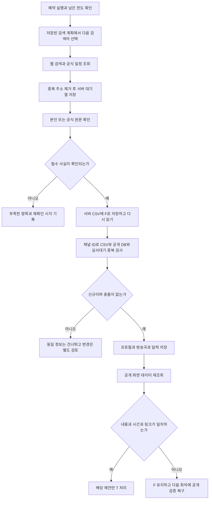

# 신규 버튜버 검색·등록 공정 구축안

**이 문서는 최종 확정 전 세부 설계 기록입니다. 현재 운영·개발 수치와 상태는 [신규버튜버자동화 최종 계획](신규버튜버자동화.md)을 따릅니다. Tavily 로컬 실검색은 완료했고, 저녁은 검색 2회·원문 6회, 대기량에 따른 조정으로 보완했습니다. 아래 과거의 키 미연결·고정 배분 설명을 현재 상태로 재사용하지 않습니다.**

2026-11-13 · VDébut · **실행 설계 문서. 이번 갱신으로 검색 연결·운영 설정·DB·배포를 변경하지 않았습니다.**

**후속 보완:** [기술·API 비교 보고서](debut-automation-technology-review-2026-11-13.md)를 함께 읽습니다. 아래 원문 확인은 출처별 허용·접근 범위를 충족해야 합니다. X HTML 자동 조회를 확정 해법으로 사용하지 않으며, X 단독 공지의 안정적 처리는 공식 API 등 별도 연결이 필요합니다. 검색 서비스만 붙여 모든 원문을 읽을 수 있다고 가정하지 않습니다.

## 1. 결론

**Cloudflare가 매일 정해진 검색어로 모르는 신인의 공지를 찾고, 원문에서 사실을 확인한 뒤, 기존 CSV·중복 검사·프로필·달력 등록 공정으로 넘깁니다.**

기본 검색 연결은 **Tavily Basic**으로 설계합니다. 이유는 요청당 사용량이 고정되고, 무료 한도 안에서 출처 주소를 저장하는 공정을 만들 수 있기 때문입니다. 검색 성능이 가장 좋다고 검증된 것은 아닙니다. SOOP 공식 일정 직접 조회는 계속 별도로 운영합니다. ChatGPT 계열 웹 검색은 추후 같은 조건으로 성과를 비교할 교체 후보이며, 매회 함께 호출하지 않습니다. Gemini Google 검색 연동은 링크 자동 수집에 관한 사용 조건 때문에 이 수집 공정에 넣지 않습니다.

검색 연결부를 교체할 수 있게 만들되, 첫 버전에서는 검색 업체 한 곳만 호출합니다. 실패했다고 다른 유료 서비스에 자동으로 넘어가지 않습니다. 계정 생성·키 연결은 아직 하지 않았습니다.

## 2. 언제 무엇을 조사하는가

모든 시각은 한국시간입니다. 현재 서버 예약은 유지하고, 아래 검색 계획을 연결합니다.

| 회차 | 조사 내용 | 일정 대상 기간 |
| --- | --- | --- |
| 매일 09:00 | 새 공지 발굴. 이름 없는 검색 4개 이하, 공식 일정·연결된 시트 확인 | 실행일 7일 전~30일 후. 오늘~7일 후 검색 우선 |
| 매일 21:00 | 오전 미처리 원문과 새 공지 조사. 임박 일정 변경·연기·취소 재확인 | 같은 기간. 오늘~3일 후 일정 우선 |
| 월요일 10:00 | 누락 검색 범위 확대, 전주 데뷔 예정이었던 채널의 빈 프로필 재확인 | 30일 전~90일 후. 상한 안에서 순환 조사 |

주간 회차도 한 번에 전체 인터넷을 조사하는 것이 아닙니다. 완료한 검색 묶음과 남은 기간을 기록해 다음 회차가 이어받습니다. 지난 일정이라고 실제 방송 완료를 표시하지 않습니다. 임박 일정이 많아 한도 내에서 모두 확인하지 못하면 미확인 채널을 보고하고 이월합니다.

## 3. 어디서 어떻게 모르는 이름을 찾는가

| 출발점 | 실제 진입 경로 | 가져올 정보와 한계 |
| --- | --- | --- |
| SOOP 공식 웰컴버추얼 | <https://welcomevirtual.sooplive.com/> | 대상 기간 공개 일정에서 이름·일시·방송국 연결. 플랫폼 데뷔를 생애 첫 데뷔로 바꾸지 않음 |
| 본인 X·공식 소속사 공지 | 이름 없는 웹 검색으로 새 게시물 주소 발견 | 본인 또는 공식 원문으로 이름·행사·일시·채널 확인. 특정 소속사 명단으로 제한하지 않음 |
| 치지직 커뮤니티 | `site:game.naver.com/lounge/chzzk`와 데뷔 검색어 조합 | 공개 검색에 색인된 글 주소. 해당 글이 본인 글인지 확인하거나 연결된 본인 공지까지 이동 |
| SOOP 방송국 공개 게시물 | `site:sooplive.com`와 버츄얼·데뷔 검색어 조합 | 검색에 색인된 공지 주소를 단서로 사용. 허용된 공개 경로만 조회 |
| 기존 공개 시트·공지 계정 | 현재 연결된 정확한 주소 유지 | 누락 보완용. 재게시만 보고 확정하지 않음 |

‘치지직/SOOP 커뮤니티를 조사했다’는 기록에는 **실제로 연 글의 주소와 확인시각**이 있어야 합니다. 검색에 그 도메인을 넣었다는 것만으로 커뮤니티 전수 조사로 보고하지 않습니다. 아직 주소를 확보하지 않은 별도 게시판을 수집 중이라고 쓰지 않습니다.

### 회차당 검색어 4개를 만드는 규칙

1. **X 발견 1개:** `site:x.com 치지직 버튜버 데뷔 2026 11월`처럼 사람 이름 없는 공지 검색. 버튜버/버츄얼, 데뷔/첫 방송, X/twitter.com 표기를 순환합니다.
2. **치지직 커뮤니티 1개:** `site:game.naver.com/lounge/chzzk 버츄얼 첫 방송 2026 11월`처럼 공개 글 검색.
3. **보완 1개:** 도메인 제한 없는 치지직 검색과 `site:sooplive.com` 검색을 번갈아 실행해 다른 출처도 찾습니다.
4. **누락 기간 1개:** 마지막으로 조사한 날짜 묶음의 다음 묶음을 검색합니다. 오전·오후가 같은 묶음만 반복하지 않게 합니다.

날짜는 현재 시각으로 생성합니다. 오늘~7일 후를 먼저 다루고, 8~30일 후와 최근 7일 누락분을 순환합니다. 월 경계에서는 다음 달 검색어를 생성합니다. 주간 확대분은 같은 대기열에서 이어갑니다. 검색어가 특정 기간을 포함해도 결과의 실제 행사일은 원문에서 다시 검사합니다.

검색 1회 결과는 최대 10개, 회차 최대 40개 링크로 제한합니다. 제목·요약은 후보 분류에만 쓰며 확정 프로필 값으로 쓰지 않습니다. 검색 결과가 없어도 쿼리·범위·시각·성공 여부를 기록합니다.

## 4. 한 회차가 처리하는 순서

검색으로 얻은 주소는 조사 대기열에 먼저 저장할 수 있습니다. **공개 프로필 등록 입력은 반드시 저장 후 다시 읽은 CSV**입니다. 이름만 있고 채널 주소가 없으면 조사 기록만 저장합니다.

### 자동 검증과 사람의 판단

- 자동 확인: 고유 채널 ID·현재 활동명·프로필 이미지 로딩, 본인/공식 출처 연결, 행사 유형·일시·시간대, 중복·운영자 수정 충돌, 공개 결과 일치.
- 자동 등록: 위 필수 사항과 기존 공개 콘텐츠 검토 기준을 모두 통과한 후보. 모든 후보를 운영자 수동 승인 대기로 보내지 않습니다.
- 보류: X 원문 접근 제한, 시간 미기재, 공지 간 충돌, 첫 데뷔/이적 구분 불가, 이미지 내용 판단 필요, 운영자 수정 충돌. 이유를 남기고 사람은 이 예외만 판단합니다.
- 소속사 공지의 신인도 같은 기준을 적용합니다. 소속사 유무는 신규 여부의 판정 기준이 아닙니다.

## 5. 얼마나 조회하고 어떻게 비용을 막는가

| 단계 | 회차 외부 요청 상한 | 처리 원칙 |
| --- | --- | --- |
| 검색 | 4회 | Tavily Basic만 사용. AI 답변·원문 통째 가져오기·고급 검색은 끔 |
| 공지 원문 | 4회 | 새 주소와 오래 기다린 주소를 함께 처리. 커뮤니티에서 원문으로 이동하는 요청도 차감 |
| 기존 고정 원천 | 12회 | 공식 일정·시트·기존 공지. 미확인 범위·후보는 이월 |
| 신규 후보 상세 확인 | 12회 | 채널·이미지·이동 요청 모두 차감. 검증 인원 12명을 뜻하지 않음 |
| 기존 일정·프로필 재확인 | 8회 | 임박 일정 우선. 주간 회차는 다른 단계 미사용분을 총 40회 안에서만 활용 가능 |
| 합계 | **40회** | 실패·재시도·리다이렉트도 차감. 한도 초과 시 다음 회차로 |

이 검색 공정의 목표 상한은 **월 70회 × 검색 4회 = 280크레딧**입니다. 실패 요청도 요청 전 먼저 예약해 보수적으로 차감합니다. 기존 월 회차·CPU 5초·DB 호출 220회·읽기 30,000행·쓰기 700행·CSV 쓰기 4MiB 상한을 늘리지 않습니다. 마감 기록의 기존 소량 예외는 유지합니다. 업체 호출 비용과 DB·CPU 예산은 별도 계수입니다.

Tavily는 현재 무료 월 1,000크레딧, Basic 요청당 1크레딧입니다. **해당 계정의 무료 잔여량이 있고 유료 종량제를 켜지 않는 조건에서 검색료 0달러를 목표**로 합니다. 검색료 0달러는 Cloudflare 계정 전체 요금 0원을 뜻하지 않습니다. [공식 요금](https://docs.tavily.com/documentation/api-credits)

검색 사용량 예약은 D1에서 원자적으로 처리합니다. 같은 월의 시험·재시도도 280회에 포함하고, 동시 회차가 중복 예약하지 못하게 합니다. 공급자 잔여량 부족·429·인증 실패 시 해당 검색을 멈추며, 이미 확보한 공식 일정·후보 검증은 남은 한도에서 계속합니다. 예약 후 결과를 못 받은 요청도 사용량을 되돌리지 않습니다.

회차 원문 4회 중 대기 후보가 있으면 최소 1회는 오래 기다린 주소에 배정합니다. 나머지는 오늘~3일 후 공지와 새 주소를 우선합니다. 특정 도메인이나 신규 검색 결과가 기존 미처리 건을 영구히 밀어내지 않게 합니다. 외부 동시 요청은 최대 3개입니다.

## 6. 서버에 무엇을 남기는가

현재 후보·공지 대기열·CSV 버전·실행 기록 테이블은 재사용합니다. 검색 계획과 사용량은 다음 두 테이블을 **추가할 설계**입니다. 아직 생성하지 않았습니다.

| 저장 단위 | 필수 항목 |
| --- | --- |
| `debut_search_tasks` | 고유 검색 키, 검색어, 플랫폼·도메인·대상 기간, 예정 시각, 완료 시각, 다음 재시도 시각, 상태·실패 사유·시도 횟수·실행 ID |
| `debut_search_usage` | 월 고유 키, 예약 크레딧, 완료 요청 수, 실패 요청 수, 마지막 갱신 시각 |
| 기존 공지 대기열 | 정규화한 원문 URL, 발견 검색 키, 최초 발견 시각, 다음 확인 시각, 확인 상태·이유. 기존 스키마에 없는 검색 키 연결 항목은 추가 필요 |
| 기존 후보·조사 CSV | 누구·언제·어디서 데뷔하는가, 행사 범위, 채널 ID·방송국 URL, 근거 URL·확인시각, 미확인 항목 |
| 기존 실행 기록 | 검색 성공·실패·미처리 묶음, 새 주소 수, 신규 채널 수, 기존 재발견 수, 등록·변경·보류·실패, 실제 요청·DB·CSV 사용량 |

검색 키는 ‘검색어+대상 기간+예정 회차’로 생성합니다. 일부 검색만 성공하면 성공 건은 완료 처리하고 실패 건만 재시도합니다. URL은 추적 문자를 제거하고 X/twitter 주소를 통일합니다. 채널 중복은 이름 대신 플랫폼+고유 ID로 판정하고 보조 채널·심사대기까지 확인합니다.

통신 실패는 다음 정기 회차, 이후 24시간·72시간 간격으로 재시도합니다. 반복 실패는 보류로 표시하고 주간 회차에 소량 재확인합니다. 로그인 제한은 우회하지 않습니다. 출처 내용이 변경됐거나 새 공식 근거가 들어오면 보류 후보를 다시 검증합니다.

## 7. 실제로 만들어야 할 순서

| 순서 | 개발 작업 | 완료 조건 |
| --- | --- | --- |
| 1 | 날짜별 검색 계획 생성·D1 저장·커서·중복 실행 방지·월 크레딧 예약 | 월 경계와 부분 실패 뒤에도 빠진 검색부터 재개. 280회 초과 호출 불가 |
| 2 | 공통 검색 결과 형식과 Tavily Basic 연결부 | 최대 4요청·결과 10개 제한, 키는 서버에만 보관. 키 미연결을 성공 0건으로 보고하지 않음 |
| 3 | 검색 결과 URL을 기존 공지 대기열에 연결 | 같은 주소 재발견을 신규 사람으로 세지 않고 다음 원문 확인으로 연결 |
| 4 | X·치지직 커뮤니티·SOOP 공지·공식 웹 공지의 원문 읽기와 증거 추출 확장 | 현재 X 중심 처리의 한계를 수정. 출처별 지원 여부·차단·본문 부족을 분리 |
| 5 | 기존 CSV·후보 검증·중복·공개 저장 공정에 연결 | 별도 등록기를 만들지 않고 기존 보호·복구 기능 재사용 |
| 6 | 모의 실패 시험 후 비공개 실검색, 신규 한 명의 전체 공정 시험 | 채널 이름을 검색 입력에 심지 않고 발견. 원문·CSV·DB·공개 링크·달력 결과 증거 확보 |
| 7 | 정기 예약 연결과 연속 회차 확인 | PC를 사용하지 않은 예약 실행에서 전 회차 미완료를 이어받음. 기존 PC 예약 중지 상태 유지 |

검색 서비스 계정과 서버용 키 연결이 필요한 외부 선행 조건은 남습니다. **키를 연결하는 것만으로 1~7번이 완성되지 않습니다.** 현재는 네이버 시험 연결부만 있고 Tavily 연결부·새 검색 계획 테이블·범용 커뮤니티 원문 처리는 아직 없습니다.

검색이나 원문 추출에서 AI를 무제한 호출하지 않습니다. 첫 버전은 출처별 명시된 항목과 구조를 읽는 방식입니다. 구조가 다른 글은 근거 부족으로 남기고, 이후 필요성이 확인되면 원문 정리용 AI의 별도 예산을 설계합니다. 모르는 값을 생성해서 자동 등록률을 높이지 않습니다.

## 8. ‘완성’이라고 보고할 기준

1. 실제 이름 없는 검색어 → 검색 결과 주소 → 본인/공식 원문을 추적할 수 있어야 합니다. 공식 목록에서 찾은 결과를 웹 검색 발굴로 바꾸어 보고하지 않습니다.
2. 검색 시점의 CSV·DB·대기열에 없던 실제 채널로 공개 반영을 확인합니다. 기존 후보 재등록 시험은 별도입니다.
3. 검증 인물의 프로필·공식 이미지·방송국 링크·달력 날짜·한국시간·기본 활동권역 필터가 맞아야 T입니다.
4. 키 없음·X 차단·원문 시간 누락·동명이인·중복·DB 실패·CSV 실패·달력 불일치·예산 소진 시험에서 잘못 공개하거나 비용 한도를 넘기지 않아야 합니다.
5. 다음 예약 회차가 대기열을 이어받고, 등록 완료 후보를 재등록하지 않는지 확인합니다.
6. 신규 0명은 정상적인 조사 결과일 수 있습니다. 검색 미실행·실패와 섞지 않고, 이번에 조사한 범위와 못한 범위를 보고합니다. 모든 신인을 전수 발견했다고 보장하지 않습니다.

성공 지표는 검색 결과 수가 아니라 **새로 발견한 고유 채널 수, 원문 확인률, 검증 가능한 신규 등록 수, 발견~공개 소요시간, 대기열 최고 대기시간, 검증 신규 한 명당 비용**입니다.

## 9. 이번 변경과 근거

이번 작업은 검색·등록 공정을 문서로 구체화하고 기존 기술 문서에 연결한 것입니다. 코드·실제 검색 연결·과금·예약·운영 DB는 변경하지 않았으며 실검색 성능 시험도 하지 않았습니다.

Tavily의 현재 [상업 이용 안내](https://help.tavily.com/articles/5880393096-permitted-use-customer-applications)와 [출처 보관 안내](https://help.tavily.com/articles/1612400809-storing-caching-retaining-output)는 이 설계의 근거입니다. 원문 사이트의 접근·이용 조건은 별도로 지킵니다. Google 검색 연동의 자동 링크 수집 제한은 [공식 조건](https://ai.google.dev/gemini-api/terms#grounding-with-google-search)을 기준으로 판단했습니다. 대안 OpenAI의 기능과 요금은 [웹 검색 문서](https://developers.openai.com/api/docs/guides/tools-web-search), [요금표](https://developers.openai.com/api/docs/pricing)를 참고합니다.
